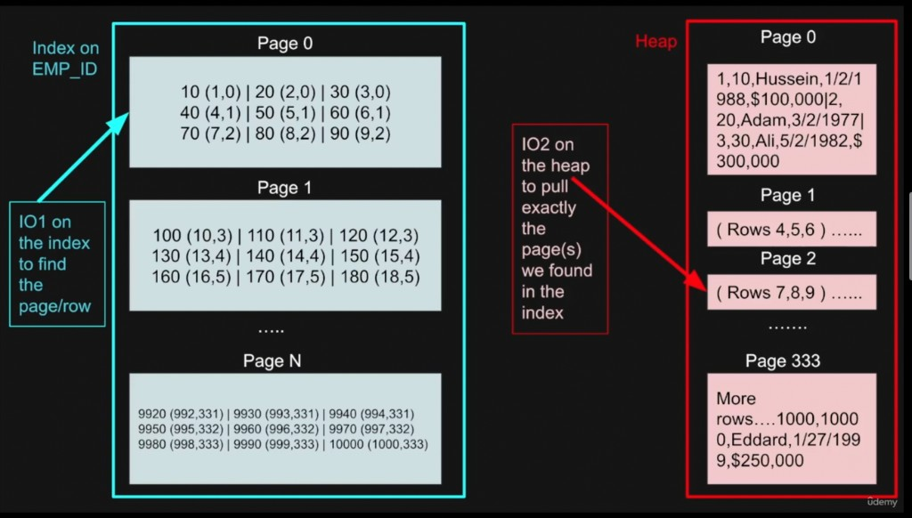
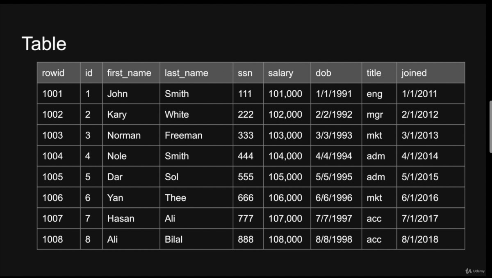
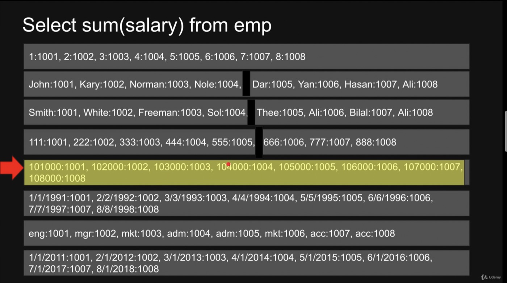

# مبانی مهندسی پایگاه‌داده (Database Engineering Fundamentals)

**مسیر یادگیری شخصی — فصل‌به‌فصل**

کتابچه اسکلت برای دنبال کردن کورس *Database Engineering Fundamentals*.
پیشرفت را علامت بزن. یادداشت فصل‌ها به‌مرور کامل می‌شود.

**سایت مستندات:** [ardavanshamroshan.github.io/database-engineering-fundumentals](https://ardavanshamroshan.github.io/database-engineering-fundumentals/)

**زبان:** فارسی · [English](README.md)

**چیت‌شیت‌ها:** [PostgreSQL](cheatsheets/postgresql.md) · [MySQL](cheatsheets/mysql.md) · [SQLite](cheatsheets/sqlite.md) · [Redis](cheatsheets/redis.md) · [MongoDB](cheatsheets/mongodb.md) · [Cassandra](cheatsheets/cassandra.md) · [ScyllaDB](cheatsheets/scylladb.md)

---

## پیشرفت

| وضعیت | تعداد |
| ----- | ----- |
| کل فصل‌ها | 17 |
| انجام‌شده | 0 |
| در حال انجام | — |

علامت‌ها: `[ ]` شروع‌نشده · `[~]` در حال انجام · `[x]` تمام‌شده

---

## نحوه استفاده

1. هر بار یک فصل بخوان (ترتیب زیر).
2. وقتی فصل تمام شد چک‌باکس را بزن.
3. یادداشت‌ها را زیر همان فصل اضافه کن.
4. اگر فقط موضوعات اصلی مهندسی را می‌خواهی، **01 / 15 / 16 / 17** را رد کن؛ برای کامل بودن در فهرست مانده‌اند.

**مسیر محلی مواد کورس:**

`/Users/ardavan/Documents/Coding/Tutorials/Database Engineering Fundumentals`

---

## فهرست مطالب

### بخش ۰ — متا

- [01 — به‌روزرسانی کورس](#01--بهروزرسانی-کورس)

### بخش ۱ — مبانی

- [02 — ACID](#02--acid)
- [03 — آشنایی با داخلیات پایگاه‌داده](#03--آشنایی-با-داخلیات-پایگاهداده)
- [04 — ایندکس‌گذاری](#04--ایندکسگذاری)
  - [04.1 — ستون‌های کلیدی و غیرکلیدی](#indexing-lesson-005)
  - [04.2 — ترکیب ایندکس‌ها](#indexing-lesson-006)
  - [04.3 — برنامه‌ریز چگونه ایندکس را انتخاب می‌کند؟](#indexing-lesson-007)
  - [04.4 — مقایسهٔ اسکن Bitmap، ایندکس و جدول](#indexing-lesson-008)
  - [04.5 — ساخت هم‌زمان ایندکس](#indexing-lesson-009)
  - [04.6 — فیلترهای بلوم](#indexing-lesson-010)
  - [04.7 — کار با جدول‌های میلیاردسطری](#indexing-lesson-011)
- [05 — B-Tree در برابر B+Tree](#05--b-tree-در-برابر-btree)
  - [05.1 — مقدمه و مسیر یادگیری](#btree-lesson-001)
  - [05.2 — اسکن کامل جدول](#btree-lesson-002)
  - [05.3 — ساختار B-Tree اصلی](#btree-lesson-003)
  - [05.4 — B-Tree چگونه کارایی را بهتر می‌کند؟](#btree-lesson-004)
  - [05.5 — محدودیت‌های B-Tree کلاسیک](#btree-lesson-005)
  - [05.6 — ساختار B+Tree و جست‌وجوی بازه‌ای](#btree-lesson-006)
  - [05.7 — ملاحظات موتور پایگاه‌داده](#btree-lesson-007)
  - [05.8 — هزینهٔ ذخیره‌سازی در PostgreSQL و MySQL InnoDB](#btree-lesson-008)
  - [05.9 — جمع‌بندی و خودآزمایی](#btree-lesson-009)

### بخش ۲ — مقیاس و توزیع

- [06 — پارتیشن‌بندی](#06--پارتیشنبندی)
  - [06.1 — مقدمه و مسیر یادگیری (درس 001)](#partitioning-lesson-001)
  - [06.2 — پارتیشن‌بندی چیست؟ (درس 002)](#partitioning-lesson-002)
  - [06.3 — پارتیشن‌بندی افقی و تفکیک عمودی (درس 003)](#partitioning-lesson-003)
  - [06.4 — انواع پارتیشن‌بندی (درس 004)](#partitioning-lesson-004)
  - [06.5 — تفاوت پارتیشن‌بندی و شاردینگ (درس 005)](#partitioning-lesson-005)
  - [06.6 — آماده‌سازی PostgreSQL، پایگاه داده، جدول و ایندکس‌ها (درس 006)](#partitioning-lesson-006)
  - [06.7 — اجرای چند کوئری روی جدول اصلی (درس 007)](#partitioning-lesson-007)
  - [06.8 — ساخت و اتصال جدول‌های پارتیشن (درس 008)](#partitioning-lesson-008)
  - [06.9 — پر کردن پارتیشن‌ها و ساخت ایندکس (درس 009)](#partitioning-lesson-009)
  - [06.10 — پروژهٔ عملی: کوئری، Pruning و اندازهٔ پارتیشن‌ها (درس 010)](#partitioning-lesson-010)
  - [06.11 — مزایای پارتیشن‌بندی (درس 011)](#partitioning-lesson-011)
  - [06.12 — معایب و محدودیت‌های طراحی (درس 012)](#partitioning-lesson-012)
  - [06.13 — جمع‌بندی و خودآزمایی (درس 013)](#partitioning-lesson-013)
  - [06.14 — خودکارسازی پارتیشن‌بندی در PostgreSQL (درس 014)](#partitioning-lesson-014)
- [07 — شاردینگ](#07--شاردینگ)
- [08 — کنترل همزمانی](#08--کنترل-همزمانی)
- [09 — Replication](#09--replication)

### بخش ۳ — سیستم‌ها و موتورها

- [10 — طراحی سیستم پایگاه‌داده](#10--طراحی-سیستم-پایگاهداده)
- [11 — موتورهای پایگاه‌داده](#11--موتورهای-پایگاهداده)
- [12 — Cursorها](#12--cursorها)

### بخش ۴ — امنیت

- [13 — امنیت پایگاه‌داده](#13--امنیت-پایگاهداده)
- [14 — رمزنگاری همومورفیک](#14--رمزنگاری-همومورفیک)

### بخش ۵ — اضافی

- [15 — پرسش و پاسخ](#15--پرسش-و-پاسخ)
- [16 — بحث‌های پایگاه‌داده](#16--بحثهای-پایگاهداده)
- [17 — لکتچرهای آرشیو](#17--لکتچرهای-آرشیو)

---

## فصل‌ها

### 01 — به‌روزرسانی کورس

- **وضعیت:** `[ ]`
- **خلاصه:** تغییرات و به‌روزرسانی مواد کورس.
- **تمرکز:** هم‌راستا ماندن با آخرین محتوای دوره.
- **یادداشت:** *(بعداً)*

---

### 02 — ACID

- **وضعیت:** `[ ]`
- **خلاصه:** چهار ویژگی تراکنش: Atomicity، Consistency، Isolation، Durability.
- **تمرکز:** تضمین‌های تراکنش در سیستم‌های رابطه‌ای.
- **یادداشت:**

ACID: **Atomicity**، **Consistency**، **Isolation**، **Durability**.

در سیستم‌های پایگاه‌داده رابطه‌ای، ACID یکپارچگی و سازگاری پایگاه‌داده را تضمین می‌کند.

#### تراکنش چیست؟ (What is a Transaction?)

تراکنش یعنی:

- گروهی از کوئری‌ها که به‌صورت یک واحد اجرا می‌شوند
- یک کار تجزیه‌ناپذیر (unit of work)
- مثال — انتقال پول بین حساب‌ها:
  - `SELECT`: بررسی کافی بودن موجودی حساب مبدأ
  - `UPDATE`: کم کردن موجودی حساب اول
  - `UPDATE`: زیاد کردن موجودی حساب دوم

```sql
START TRANSACTION;
SELECT * FROM account WHERE account_id = 1;
-- IF balance < 100 THEN ROLLBACK;
UPDATE account SET balance = balance - 100 WHERE account_id = 1;
UPDATE account SET balance = balance + 100 WHERE account_id = 2;
COMMIT;
```

اگر موجودی کافی نباشد → `ROLLBACK`؛ پایگاه‌داده در حالت قبلی می‌ماند.  
اگر کافی باشد → `COMMIT`؛ پایگاه‌داده به حالت جدید می‌رود.

برای امکان Undo، تغییرات اول در حافظه نوشته می‌شوند؛ فقط بعد از تأیید، به دیسک commit می‌شوند.

#### Atomicity (اتمی بودن)

تراکنش یک واحد اتمیک است که یا کامل موفق می‌شود یا کامل شکست می‌خورد. همه کوئری‌های داخل تراکنش باید با هم موفق یا با هم ناموفق باشند.

##### آزمایش: اثبات Atomicity با تراکنش ناتمام (PostgreSQL)

**هدف:** نشان بده تغییر commit‌نشده دائمی نمی‌شود. اگر session بدون `COMMIT` تمام شود، PostgreSQL تراکنش را rollback می‌کند — همه یا هیچ.

**انتظار ما**

| لحظه | `products.inventory` |
| ---- | -------------------- |
| قبل از `BEGIN` | `10` |
| داخل تراکنش باز، بعد از `UPDATE` | `0` (فقط در همین session دیده می‌شود) |
| بعد از قطع اتصال بدون `COMMIT` | دوباره `10` (rollback) |

**چرا این آزمایش Atomicity را ثابت می‌کند؟**

- داخل تراکنش موجودی را `0` می‌بینی.
- هرگز `COMMIT` نمی‌زنی.
- با خروج از `psql` تراکنش باز abort می‌شود → خودکار `ROLLBACK`.
- واحد کار کامل نشد → هیچ‌کدام از تغییراتش باقی نمی‌ماند.
- این همان Atomicity است: یا کامل موفق، یا طوری که انگار اصلاً اجرا نشده.

> **نکته:** اینجا غیرمستقیم Durability هم دیده می‌شود: فقط کار *commit‌شده* ماندگار است. کار commit‌نشده بعد از abort باید ناپدید شود.

**۱) آماده‌سازی**

```sql
CREATE DATABASE app;
\c app

CREATE TABLE products (
  id SERIAL PRIMARY KEY,
  name TEXT,
  price FLOAT,
  inventory INTEGER
);

CREATE TABLE sales (
  id SERIAL PRIMARY KEY,
  product_id INTEGER,
  price FLOAT,
  quantity INTEGER
);

INSERT INTO products (id, name, price, inventory)
VALUES (1, 'Phone', 999.99, 10);

SELECT * FROM products;
-- id=1, name=Phone, price=999.99, inventory=10
```

**۲) شروع تراکنش و تغییر موجودی (بدون commit)**

```sql
BEGIN;

UPDATE products SET inventory = inventory - 10;

SELECT * FROM products;
-- در همین session موجودی 0 است
```

**۳) خروج بدون `COMMIT`**

کلاینت را ببند (مثلاً خروج از `psql`) در حالی که تراکنش هنوز باز است. PostgreSQL آن را abort می‌کند.

**۴) اتصال دوباره و بررسی**

```sql
\c app
SELECT * FROM products;
-- موجودی دوباره 10 است
```

**نتیجه:** داخل تراکنش `UPDATE` واقعی به نظر می‌رسید، ولی بعد از abort پایگاه‌داده به حالت معتبر قبلی برگشت. واحد اتمیک = همه یا هیچ.

**گام اختیاری بعدی:** همین مراحل را تکرار کن، فقط قبل از خروج `COMMIT;` بزن. بعد از reconnect موجودی باید `0` بماند.

#### Consistency (سازگاری)

تراکنش باید پایگاه‌داده را از یک حالت معتبر به حالت معتبر دیگر ببرد.

- **سازگاری در داده (Consistency in data)**
  - توسط کاربر تعریف می‌شود
  - یکپارچگی ارجاعی (Referential integrity / foreign keys)
  - مرتبط با Atomicity تراکنش
  - مرتبط با Isolation تراکنش
- **سازگاری در خواندن (Consistency in reads)**
  - اگر تراکنشی تغییر را commit کرد، تراکنش جدید فوراً آن را می‌بیند؟
  - روی کل سیستم اثر دارد
  - هم رابطه‌ای و هم NoSQL با این موضوع روبه‌رو هستند
  - سازگاری نهایی (Eventual consistency)

#### Isolation (انزوا)

**Isolation Level** مشخص می‌کند تراکنش‌های هم‌زمان چه نسخه‌ای از دادهٔ هم را می‌بینند.

PostgreSQL از **MVCC** (کنترل همزمانی چندنسخه‌ای) استفاده می‌کند: معمولاً خواننده نویسنده را بلوکه نمی‌کند و برعکس. Isolation فقط تعیین می‌کند *کدام نسخه* سطر را می‌بینی.

مثال ساده: یک تراکنش `UPDATE` می‌زند، دیگری روی همان سطرها `SELECT` می‌کند. سطح Isolation تصمیم می‌گیرد خواننده نسخهٔ قدیمی را ببیند، منتظر بماند، یا snapshot ثابت از شروع تراکنش را ببیند.

سؤال: آیا تراکنش در حال اجرا می‌تواند تغییرات تراکنش‌های دیگر را ببیند؟

**تراکنش ۱:**

```sql
SELECT id, quantity FROM products WHERE id = 1;
SELECT SUM(quantity) FROM products;
```

**تراکنش ۲:**

```sql
UPDATE products SET quantity = quantity - 1 WHERE id = 1;
```

اگر Isolation نباشد، نتیجه می‌تواند غلط شود.

##### ناهنجاری‌های اصلی

**Dirty read (خواندن کثیف)** — تراکنش A داده را عوض کرده ولی هنوز commit نکرده. `SELECT` تراکنش B همان تغییرات معلق را می‌خواند. اگر A بعداً rollback کند، B از قبل دادهٔ نامعتبر دیده است.

**Non-repeatable read** — سطری را می‌خوانی؛ تراکنش دیگر UPDATE/DELETE را commit می‌کند؛ `SELECT` بعدی تو مقدار متفاوت (یا بدون سطر) می‌بیند.

**Phantom read (خواندن شبح)** — وسط `SELECT`های تراکنش A، تراکنش دیگری سطرهای مطابق شرط A را INSERT (یا DELETE) می‌کند. `SELECT` بعدی A مجموعهٔ متفاوتی می‌بیند.

| ناهنجاری | چه چیزی عوض شد؟ |
| -------- | --------------- |
| Dirty read | تغییرات **commit‌نشده** تراکنش دیگر را خواندی |
| Non-repeatable read | یک **سطر موجود** که قبلاً خوانده بودی **آپدیت** (یا حذف) شد |
| Phantom read | **مجموعه سطرهای** مطابق کوئری بزرگ/کوچک شد |

##### سطوح Isolation در PostgreSQL (نمای کلی)

| سطح | رفتار در PostgreSQL | Dirty | Non-repeatable | Phantom |
| --- | ------------------- | ----- | -------------- | ------- |
| **Read Uncommitted** | پذیرفته می‌شود، ولی مثل **Read Committed** عمل می‌کند (Dirty واقعی نیست) | 🟢 | 🔴 | 🔴 |
| **Read Committed** | **پیش‌فرض.** هر statement فقط دادهٔ commit‌شده قبل از شروع همان statement را می‌بیند | 🟢 | 🔴 | 🔴 |
| **Repeatable Read** | Snapshot از لحظهٔ شروع تراکنش؛ خواندن پایدار؛ معمولاً بدون phantom | 🟢 | 🟢 | 🟢 |
| **Serializable** | Snapshot + تشخیص تعارض (SSI)؛ ممکن است تراکنش با serialization failure abort شود | 🟢 | 🟢 | 🟢 |

> در PostgreSQL سطح جداگانه‌ای به نام **`SNAPSHOT`** نیست. **Repeatable Read** همان رفتار snapshot isolation را می‌دهد. **Serializable** قوی‌تر است (SSI).

##### آماده‌سازی آزمایش‌های PostgreSQL

دو session جدا در `psql` به دیتابیس `app` وصل کن (همان DB آزمایش Atomicity، یا بساز). یک‌بار:

```sql
CREATE DATABASE app;          -- اگر از قبل هست رد شو
\c app

DROP TABLE IF EXISTS test_table;
CREATE TABLE test_table (
  id SERIAL PRIMARY KEY,
  field1 INT,
  field2 INT,
  field3 INT
);

INSERT INTO test_table (field1, field2, field3) VALUES
  (1, 2, 3),
  (1, 2, 3),
  (1, 2, 3),
  (1, 2, 3);
```

برای فرصت سوییچ بین sessionها از `pg_sleep(10)` استفاده کن.

##### ۱) Read Uncommitted (در PostgreSQL = Read Committed)

در استاندارد SQL ضعیف‌ترین سطح است و می‌تواند Dirty read بدهد. **در PostgreSQL، `READ UNCOMMITTED` مثل `READ COMMITTED` رفتار می‌کند** — دادهٔ commit‌نشده session دیگر را نمی‌بینی.

**Session 1:**

```sql
BEGIN;
UPDATE test_table SET field1 = 2;
SELECT pg_sleep(10);
ROLLBACK;
```

**Session 2 (وسط sleep سشن ۱):**

```sql
SET TRANSACTION ISOLATION LEVEL READ UNCOMMITTED;
SELECT * FROM test_table;
```

هنوز مقادیر **قدیمی commit‌شده** را می‌بینی (`field1 = 1`)، نه `2`. Dirty read رخ نمی‌دهد. این رفتار عمدی PostgreSQL است.

##### ۲) Read Committed (پیش‌فرض)

هر statement فقط سطرهایی را می‌بیند که قبل از **شروع همان statement** commit شده‌اند. Dirty نمی‌بینی. بین statementهای یک تراکنش، UPDATEهای **commit‌شده** دیگران هنوز می‌توانند دید تو را عوض کنند → Non-repeatable / Phantom ممکن است.

**نمایش Non-repeatable read**

**Session 1:**

```sql
BEGIN;  -- پیش‌فرض = READ COMMITTED
SELECT * FROM test_table WHERE id = 1;
SELECT pg_sleep(10);
SELECT * FROM test_table WHERE id = 1;  -- بعد از commit سشن ۲ ممکن است فرق کند
COMMIT;
```

**Session 2 (وسط sleep):**

```sql
UPDATE test_table SET field1 = 7 WHERE id = 1;
-- در psql اگر تراکنش باز نکرده باشی auto-commit است
```

select اول سشن ۱: `field1 = 1`. بعد از commit سشن ۲، select دوم: `field1 = 7`. Non-repeatable read.

**خواننده در برابر نویسنده (MVCC):** معمولاً `SELECT` سشن ۲ پشت `UPDATE` باز سشن ۱ **گیر نمی‌کند** — نسخهٔ قبلی commit‌شده را می‌خواند. بلوکه عمدتاً وقتی دو writer روی یک سطر تعارض دارند پیش می‌آید.

##### ۳) Repeatable Read (snapshot)

PostgreSQL در شروع تراکنش یک **snapshot** می‌گیرد. همهٔ statementهای آن تراکنش همان حالت commit‌شده را می‌بینند. UPDATEهای commit‌شده دیگران وارد دید تو نمی‌شوند. INSERTهای phantom هم معمولاً **دیده نمی‌شوند**.

**Session 1:**

```sql
BEGIN;
SET TRANSACTION ISOLATION LEVEL REPEATABLE READ;
SELECT * FROM test_table WHERE id = 1;
SELECT pg_sleep(10);
SELECT * FROM test_table WHERE id = 1;  -- مثل select اول
COMMIT;
```

**Session 2 (وسط sleep):**

```sql
UPDATE test_table SET field1 = 7 WHERE id = 1;
```

هر دو select در سشن ۱ هنوز `field1` قدیمی را نشان می‌دهند. commit سشن ۲ به snapshot سشن ۱ نشت نمی‌کند.

اگر سشن ۱ بعداً همان سطری را `UPDATE` کند که سشن ۲ عوض کرده، ممکن است خطا بگیری: `could not serialize access due to concurrent update`.

##### ۴) Serializable (SSI)

قوی‌ترین سطح در PostgreSQL. مثل snapshot در Repeatable Read، به‌علاوه **تشخیص شکست سریال‌سازی**. اگر الگوی خطرناک هم‌زمانی دیده شود، یک تراکنش abort می‌شود و باید retry کند.

```sql
BEGIN;
SET TRANSACTION ISOLATION LEVEL SERIALIZABLE;
-- خواندن/نوشتن تو
COMMIT;
```

در تعارض ممکن است ببینی:

```text
ERROR: could not serialize access due to read/write dependencies among transactions
```

الگوی اپلیکیشن: خطا را بگیر → کل تراکنش را دوباره اجرا کن.

##### آزمایش Phantom read (PostgreSQL)

**Phantom read** وقتی است که تراکنش **همان کوئری را دو بار** اجرا کند و بار دوم **سطرهای جدید** مطابق `WHERE` ببیند — چون تراکنش دیگری INSERT مطابق را commit کرده است.

**آماده‌سازی (یک‌بار):**

```sql
\c app
DROP TABLE IF EXISTS products;
CREATE TABLE products (
  id SERIAL PRIMARY KEY,
  name TEXT,
  price FLOAT,
  inventory INTEGER
);
INSERT INTO products (name, price, inventory)
VALUES ('Phone', 999.99, 10);
```

**نمایش phantom زیر Read Committed**

**Session A:**

```sql
BEGIN;
SET TRANSACTION ISOLATION LEVEL READ COMMITTED;

SELECT COUNT(*) FROM products WHERE price > 500;
-- 1
SELECT pg_sleep(10);
SELECT COUNT(*) FROM products WHERE price > 500;
-- 2  ← phantom
COMMIT;
```

**Session B (وسط sleep):**

```sql
INSERT INTO products (name, price, inventory)
VALUES ('Laptop', 1299.00, 5);
```

**چه اتفاقی افتاد؟**

1. Session A شمارش `price > 500` → `1` (Phone).
2. Session B لپ‌تاپ (`1299`) را insert و commit کرد.
3. شمارش دوم Session A → `2`.
4. سطر اضافه همان **phantom** است.

**بستن phantom با Repeatable Read**

همان اسکریپت در Session A، ولی:

```sql
BEGIN;
SET TRANSACTION ISOLATION LEVEL REPEATABLE READ;
SELECT COUNT(*) FROM products WHERE price > 500;
SELECT pg_sleep(10);
SELECT COUNT(*) FROM products WHERE price > 500;
-- هنوز 1
COMMIT;
```

INSERT سشن B می‌تواند commit شود؛ snapshot سشن A تا قبل از commit خودش آن را نمی‌بیند.

##### Serializable در برابر Phantom Read

**Phantom read** = دو بار همان `SELECT`؛ بین دو اجرا INSERT/DELETE مطابق شرط؛ مجموعهٔ نتیجه عوض می‌شود.

| | Read Committed | Repeatable Read (PostgreSQL) | Serializable |
| - | -------------- | ---------------------------- | ------------ |
| UPDATEهای commit‌شده دیگران وسط تراکنش دیده می‌شود؟ | بله (per statement) | خیر (snapshot) | خیر (snapshot + SSI) |
| Phantom از INSERT؟ | 🔴 ممکن | 🟢 معمولاً بسته | 🟢 بسته |
| ممکن است تراکنش abort شود؟ | برای این مورد نادر | روی نوشتن متعارض همان سطر | روی تعارض تشخیص‌داده‌شده SSI |

**PostgreSQL چطور در Repeatable Read phantom را می‌بندد؟**

- Snapshot در `BEGIN` / اولین کوئری تراکنش RR ثابت می‌شود.
- INSERTهایی که بعد از آن snapshot commit شوند برای تو نامرئی‌اند.
- معمولاً به range lock به‌سبک بعضی موتورهای قفل‌محور نیاز نیست.

**کی Serializable؟**

- وقتی قواعد کسب‌وکار نیاز به اجرای واقعاً سریال دارند (مثلاً دو تراکنش هر کدام یک مجموعه را می‌خوانند و بر اساس آن می‌نویسند).
- انتظار `could not serialize access` گاه‌به‌گاه → retry.

**معنای Snapshot در برابر Serializable (PostgreSQL)**

- **Repeatable Read** ≈ snapshot isolation (دید پایدار؛ بدون Dirty / Non-repeatable / phantom معمول).
- **Serializable** = snapshot + بررسی وابستگی؛ برای الگوهای نوشتن پیچیده امن‌تر، احتمال retry بیشتر.

**پیاده‌سازی Isolation در پایگاه‌داده:**

- Isolation در PostgreSQL روی **MVCC** + snapshot (+ SSI برای Serializable) بنا شده
- موتورهای **Pessimistic** بیشتر روی قفل تکیه می‌کنند؛ خواننده‌های PostgreSQL بیشتر با نسخه کار می‌کنند
- مدیریت **Optimistic** وقتی writerهای RR/Serializable برخورد می‌کنند دیده می‌شود — fail و retry

#### Durability (دوام)

تراکنش پایدار است: بعد از commit، حتی با قطع برق یا کرش سیستم از بین نمی‌رود. تغییرات کلاینت باید ماندگار بمانند.

**Durability در عمل**

راهکارهای رایج:

- **Write-Ahead Logging (WAL)** — قبل از تغییر فایل‌های اصلی، تغییرات در لاگ ثبت می‌شود؛ بعد از کرش با replay لاگ، کار commit‌شده بازیابی می‌شود
- **Write-Through Logging (WTL)** — هم‌زمان به لاگ و پایگاه‌داده می‌نویسد؛ ریسک از دست رفتن داده کمتر و هم‌راستایی لاگ و storage بهتر
- **Write-Behind / Write-Back Logging (WBL)** — اول لاگ؛ به‌روزرسانی فایل اصلی عقب می‌افتد (اغلب batch). سریع‌تر است ولی recovery باید دقیق باشد
- **تفاوت DBMSها** — موتورها این استراتژی‌ها را با تعادل سرعت در برابر ایمنی ترکیب می‌کنند

لاگ‌گذاری تضمین می‌کند که بعد از commit، recovery بتواند دادهٔ آسیب‌دیده را بازسازی کند.

#### سازگاری نهایی (Eventual Consistency)

**Consistency** در ACID یعنی تراکنش پایگاه‌داده را از یک حالت معتبر به حالت معتبر دیگر می‌برد.

در سیستم‌های توزیع‌شده و بسیاری از NoSQLها، **Eventual consistency** رایج است: اگر به‌اندازه کافی بدون آپدیت جدید بگذرد، همه replicaها هم‌گرا می‌شوند — اما سازگاری فوری بعد از هر نوشتن تضمین نیست.

در راه‌اندازی‌های رابطه‌ای توزیع‌شده هم، وقتی اولویت Availability و Partition tolerance باشد، ممکن است دیده شود.

**نکات کلیدی:**

- Consistency در ACID یعنی اعمال قوانین یکپارچگی بعد از هر تراکنش
- Eventual consistency اختلاف موقت بین نودها را می‌پذیرد؛ با زمان هم‌گرا می‌شوند
- فقط مخصوص NoSQL نیست

**مثال**

Master به نام `A` و دو replica به نام `A1` و `A2`:

1. مقدار `X` روی master `A` آپدیت می‌شود
2. قبل از تمام شدن replication از `A1` می‌خوانی → مقدار قدیمی `X` (ناسازگاری موقت)
3. بعد از رسیدن آپدیت به `A1` و `A2`، همه نودها همان `X` به‌روز را دارند

سازگاری فوری تضمین نیست؛ وقتی replicaها sync شوند، سیستم در نهایت سازگار می‌شود.

---

### 03 — آشنایی با داخلیات پایگاه‌داده

- **وضعیت:** `[ ]`
- **خلاصه:** داده داخل پایگاه‌داده چطور ذخیره و پیدا می‌شود.
- **تمرکز:** پشت صحنه — storage، صفحات، ایندکس، و IO.

#### جدول و ایندکس چطور ذخیره و پیدا می‌شوند — ساده

**ایده‌های کلیدی ذخیره‌سازی:**

- **Table (جدول):** یک جدول شبکه‌ای از سطرها و ستون‌ها.

  *مثال:*

  | id | name    | email              |
  |----|---------|--------------------|
  | 1  | Alice   | alice@email.com    |
  | 2  | Bob     | bob@email.com      |
  | 3  | Charlie | charlie@email.com  |

  هر سطر یک رکورد است. ستون‌ها فیلدهای داده هستند.

  *نمونه کد PostgreSQL:*
  ```sql
  CREATE TABLE users (
    id SERIAL PRIMARY KEY,
    username VARCHAR(50) NOT NULL,
    email VARCHAR(100) UNIQUE NOT NULL,
    created_at TIMESTAMP DEFAULT NOW()
  );
  ```

- **Row ID:** هر سطر یک شناسه یکتا دارد تا پایگاه‌داده سریع همان سطر را پیدا کند. گاهی primary key است؛ گاهی (مثل PostgreSQL) یک مقدار سیستمی پنهان.

- **Page (صفحه):** پایگاه‌داده داده را در «صفحه» جابه‌جا می‌کند — تکه‌هایی معمولاً 8KB یا 16KB. یک صفحه چند سطر نگه می‌دارد. وقتی می‌خواند، کل صفحه را می‌گیرد نه تک‌سطر.

    - مثال: اگر هر صفحه ۳ سطر جا بدهد و جدول ۱٬۰۰۱ سطر داشته باشد، حدود ۳۳۴ صفحه لازم است.

- **IO (Input/Output):** خواندن/نوشتن بین حافظه و دیسک/SSD. هر IO حداقل یک صفحه کامل می‌خواند، نه یک سطر تکی. IO زیاد = پایگاه‌داده کند.

- **Heap:** روش سادهٔ ذخیرهٔ سطرهای جدول: هر سطر را در اولین جای خالی می‌گذارد (بدون مرتب‌سازی). Insert سریع است، ولی جستجو بدون کمک کند است.

    - برای پیدا کردن سریع بدون گشتن همه‌جا، نیاز داری به...

- **Index (ایندکس):** مثل نقشه است که مستقیم به سطر(ها) در جدول (همان «Heap») اشاره می‌کند. اغلب به‌صورت **B-Tree** یا **B+Tree** — درخت‌های مرتب که جستجو را خیلی سریع می‌کنند.

    - **ایندکس چطور کار می‌کند:**
      1. ایندکس دادهٔ کلید (بعضی ستون‌ها) را نگه می‌دارد.
      2. برای هر کلید، pointer به محل در Heap دارد (کدام صفحه، کدام سطر).
      3. در ایندکس جستجو می‌کنی؛ پایگاه‌داده دقیق می‌فهمد رکورد کجاست — بدون اسکن کل جدول.

    - **نکات ایندکس:**
        - می‌تواند یک یا چند ستون را پوشش دهد (موقع ساخت انتخاب می‌کنی).
        - مثل جدول در صفحه ذخیره می‌شود، ولی معمولاً کوچک‌تر و حافظه‌دوست‌تر است.
        - رایج‌ترین ساختار: **B-Tree** یا **B+Tree**.

    - **تصویر ذهنی:**
      ```
      [Index on email]
           |
       "bob@email.com"
           |
      points to
           |
      [Heap Page X] → Row for Bob
      ```

**جمع‌بندی:**
- داده در جدول‌ها ذخیره می‌شود (سطر و ستون).
- هر سطر داخل یک صفحه می‌نشیند.
- پایگاه‌داده صفحه جابه‌جا می‌کند، نه تک‌سطر.
- Heap سطرها را هر جا جا باشد می‌چیند.
- ایندکس کمک جستجو است — مستقیم به داده اشاره می‌کند تا همهٔ سطرها را نگردی.



**نمودار — جستجو با ایندکس در برابر خواندن از Heap**

1. **IO1 روی ایندکس:** در ایندکس `EMP_ID` بگرد تا pointer به شکل `(page_id, row_id)` پیدا شود.
2. **IO2 روی Heap:** با همان pointer صفحهٔ درست Heap را بخوان و کل سطر را بگیر.

در PostgreSQL هم ایده یکی است: ایندکس ثانویه کلید + اشاره‌گر به tuple در Heap (`ctid`) را نگه می‌دارد؛ معمولاً حداقل یک IO ایندکس + یک IO Heap.

- **مثال کوئری:**  
  فرض کن جدول employees با ایندکس روی `email` داری.

  - **کوئری:**  
    ```sql
    SELECT * FROM employees WHERE email = 'bob@email.com';
    ```

  - **فقط Heap (بدون ایندکس):**  
    پایگاه‌داده باید همهٔ سطرها را اسکن کند تا ایمیل Bob را پیدا کند. اگر ۱۰٬۰۰۰ سطر باشد، همه را چک می‌کند (ممکن است صدها صفحه!). برای جدول بزرگ خیلی کند است.

  - **با ایندکس:**  
    1. اول `'bob@email.com'` را در **ایندکس** پیدا می‌کند (سریع، معمولاً ۱ یا ۲ صفحه).
    2. ایندکس دقیق می‌گوید کدام صفحه و سطر Heap دادهٔ Bob را دارد.
    3. مستقیم همان‌جا می‌پرد و فقط همان صفحه را برای کل سطر می‌خواند.
    4. نتیجه: به‌جای اسکن همه چیز، معمولاً فقط ۲ خواندن (IO). خیلی سریع‌تر!

  #### پایگاه‌داده Row-Oriented در برابر Column-Oriented

- **Row-Oriented (ذخیره‌سازی سطری / Row Store):**  
  - کل هر سطر را کنار هم در هر بلوک دیسک نگه می‌دارد؛ همهٔ ستون‌های یک سطر کنار هم هستند.
  - خواندن یک بلوک، سطرهای کامل را یکجا می‌دهد (همهٔ ستون‌ها و مقادیرشان برای هر سطر).
  - اسکن برای پیدا کردن سطر خاص ممکن است چند IO ببرد، ولی وقتی سطر پیدا شد همهٔ داده‌اش با هم لود می‌شود.
  - بهترین برای:
    - سیستم‌های تراکنشی (OLTP) که اغلب کل سطر را می‌خوانند یا می‌نویسند (مثلاً insert/update رکورد).
    - بارهایی که برای join یا تغییر، یکپارچگی سطر مهم است.
    - مثال سیستم‌ها: PostgreSQL، MySQL، SQLite و غیره.
    - مثال جدول (ذخیرهٔ سطری):
      | id | name    | email              |
      |----|---------|--------------------|
      | 1  | Alice   | alice@email.com    |
      | 2  | Bob     | bob@email.com      |
      | 3  | Charlie | charlie@email.com  |



- **Column-Oriented (ذخیره‌سازی ستونی / Column Store):**  
  - همهٔ مقادیر هر ستون را در بلوک‌های جدا (تکه‌های ستونی) نگه می‌دارد؛ پس مقادیر یک ستون از نظر فیزیکی کنار هم هستند.
  - خواندن یک بلوک، مقادیر زیاد از **یک** ستون می‌دهد، نه سطر کامل.
  - گرفتن همهٔ مقادیر یک ستون (برای فیلتر یا aggregation) خیلی سریع و کارآمد است — ممکن است فقط چند بلوک لازم باشد. ولی بازسازی سطر کامل از روی چند ستون می‌تواند IO بیشتری بخواهد.
  - بهترین برای:
    - بارهای تحلیلی (OLAP) مثل گزارش، aggregation، و فیلتر روی جدول‌های خیلی بزرگ.
    - وقتی معمولاً فقط چند ستون را یکجا پردازش می‌کنی، یا می‌خواهی مجموعهٔ بزرگ را ستونی اسکن کنی.
    - مثال سیستم‌ها: ClickHouse، Amazon Redshift، Vertica، Apache Parquet و غیره.
    - مثال (نمای ساده) — ستون‌ها جدا ذخیره شده‌اند:
      ```
      id:    [1,   2,    3,    ...]
      name:  [Alice, Bob, Charlie, ...]
      email: [alice@email.com, bob@email.com, charlie@email.com, ...]
      ```

#### مزایا و معایب

| پایگاه‌داده Row-Oriented | پایگاه‌داده Column-Oriented |
| ------------------------ | --------------------------- |
| سریع برای خواندن/نوشتن تراکنشی (سطر کامل) | کندتر برای نوشتن، مخصوصاً وقتی ستون‌های زیاد یکجا تغییر کنند |
| مناسب OLTP (تراکنش، آپدیت مکرر) | مناسب OLAP (آنالیتیکس، aggregation، گزارش) |
| فشرده‌سازی داده معمولاً ضعیف‌تر | فشرده‌سازی عالی (شباهت مقادیر یک ستون) |
| برای aggregation کم‌بازده | برای aggregation، فیلتر، اسکن چند ستون بسیار کارآمد |
| برای کوئری‌هایی که خیلی/همهٔ ستون‌های یک سطر را می‌خواهند کارآمد | برای point query که سطر کامل می‌خواهد کم‌بازده |




### 04 — ایندکس‌گذاری

- **وضعیت:** `[ ]`
- **خلاصه:** پیدا کردن سریع‌تر سطرها، انتخاب ایندکس برای کوئری‌های واقعی و سنجش نتیجه.
- **تمرکز:** روش‌های خواندن داده، ستون‌های کلیدی و پوششی، انواع ایندکس و هزینهٔ خواندن و نوشتن.

**هدف یادگیری:** در پایان این فصل بتوانید توضیح دهید چرا یک کوئری از ایندکس استفاده می‌کند، ایندکس مناسبی بسازید و تأثیر آن را بسنجید.

#### ۱. ایندکس چه کاری انجام می‌دهد؟

ایندکس را مثل نمایهٔ یک کتاب در نظر بگیرید: موضوع موردنظر را بدون خواندن همهٔ صفحه‌ها پیدا می‌کنید. در PostgreSQL، سطرهای جدول در **Heap** ذخیره می‌شوند و ایندکس ساختاری جداگانه است که به آن سطرها اشاره می‌کند.

**B-Tree**، نوع پیش‌فرض ایندکس، کلیدها را به‌ترتیب و همراه با ارجاع به سطرهای Heap نگه می‌دارد. این ساختار برای تساوی (`=`)، بازه‌ها (`>` و `BETWEEN`) و عبارت‌های سازگار با `ORDER BY` مفید است. ساختن آن، خود جدول را مرتب نمی‌کند.


**هزینه و فایده:** ایندکس می‌تواند کار لازم برای خواندن را کاهش دهد، اما فضای دیسک می‌گیرد و هزینهٔ نوشتن و نگهداری را افزایش می‌دهد. آن را برای کوئری‌هایی بسازید که واقعاً به بهبود سرعت نیاز دارند.

#### ۲. تمرین: مقایسهٔ کوئری قبل و بعد از ساخت ایندکس

از یک پایگاه‌دادهٔ تمرینی PostgreSQL استفاده کنید. بلوک‌ها را به‌ترتیب، در یک نشست و با فعال بودن autocommit اجرا کنید. جدول موقت با قطع اتصال حذف می‌شود؛ برای تکرار تمرین، نشست تازه‌ای باز کنید.

**گام اول: ساخت ۱۰۰٬۰۰۰ سطر.**

```sql
CREATE TEMP TABLE indexing_employees (
  id integer PRIMARY KEY,
  name text NOT NULL,
  email text NOT NULL,
  department_id integer NOT NULL,
  active boolean NOT NULL
);

INSERT INTO indexing_employees
SELECT n,
       'User ' || n,
       'user' || n || '@example.com',
       n % 100,
       n % 10 = 0
FROM generate_series(1, 100000) AS g(n);

ANALYZE indexing_employees;
```

کلید اصلی، یک B-Tree یکتا روی `id` می‌سازد؛ برای `email` ایندکسی ایجاد نمی‌کند. دستور `ANALYZE` آمار داده‌ها را در اختیار برنامه‌ریز کوئری قرار می‌دهد.

**گام دوم: سنجش جست‌وجوی ایمیل بدون ایندکس ایمیل.**

```sql
EXPLAIN (ANALYZE, BUFFERS)
SELECT id, name
FROM indexing_employees
WHERE email = 'user50000@example.com';
```

انتظار می‌رود **Seq Scan** ببینید: PostgreSQL جدول را می‌خواند و سطرهای نامرتبط را کنار می‌گذارد. برنامهٔ اجرا و زمان آن را یادداشت کنید.

**گام سوم: ساخت ایندکس و اجرای دوبارهٔ همان کوئری.**

```sql
CREATE INDEX indexing_employees_email_idx
ON indexing_employees (email);

EXPLAIN (ANALYZE, BUFFERS)
SELECT id, name
FROM indexing_employees
WHERE email = 'user50000@example.com';
```

انتظار می‌رود **Index Scan** ببینید: ایمیل در ایندکس پیدا می‌شود، سپس `id` و `name` از Heap خوانده می‌شوند. میزان کار و زمان اجرا را با گام دوم مقایسه کنید.

برنامه و زمان اجرا به داده‌ها، تنظیمات و وضعیت کش بستگی دارند. هر کوئری را چند بار اجرا و نتایج را در شرایط مشابه مقایسه کنید؛ انتظار ضریب افزایش سرعت ثابتی نداشته باشید.

#### ۳. خواندن برنامهٔ اجرای کوئری

| روش اجرا | شیوهٔ دریافت داده | کاربرد رایج |
| --- | --- | --- |
| **Seq Scan** | صفحه‌های جدول را می‌خواند و شرط را بررسی می‌کند. | جدول کوچک یا کوئری با تعداد زیادی سطر خروجی. |
| **Index Scan** | ورودی‌های ایندکس را پیدا می‌کند، سپس به Heap مراجعه می‌کند. | جست‌وجوی محدود با نیاز به ستون‌های خارج از ایندکس. |
| **Index Only Scan** | مقدارها را از ایندکس می‌گیرد؛ وضعیت رؤیت‌پذیری را بررسی می‌کند و ممکن است به Heap مراجعه کند. | کوئری‌هایی که ستون‌های موردنیازشان در ایندکس موجود است. |
| **Bitmap Index Scan + Bitmap Heap Scan** | محل سطرها را جمع‌آوری می‌کند، سپس صفحه‌های Heap را به‌ترتیب می‌خواند. | دریافت چندین سطر یا ترکیب چند ایندکس. |

ابتدا این بخش‌های خروجی را بررسی کنید:

- **Index Cond:** شرطی که برای جست‌وجو در ایندکس استفاده شده است.
- **Filter / Rows Removed by Filter:** بررسی و حذف سطرها پس از دریافت سطرهای احتمالی.
- **تعداد سطرهای تخمینی و واقعی:** اختلاف زیاد می‌تواند نشانهٔ آمار قدیمی یا دشواری تخمین توزیع داده‌ها باشد.
- **Buffers:** دسترسی به صفحه‌ها از حافظه یا با خواندن داده؛ این عدد، تعداد صفحه‌های یکتا یا عملیات فیزیکی دیسک نیست.
- **Heap Fetches:** تعداد مراجعه‌ها به Heap در اسکن فقط ایندکس. صفر یعنی آن اجرا به مراجعه به Heap نیاز نداشته است.
- **Execution Time:** زمان اجرای کوئری اندازه‌گیری‌شده؛ هزینهٔ تخمینی برنامه‌ریز جداست و برحسب میلی‌ثانیه نیست.

`EXPLAIN` تخمین‌ها را نشان می‌دهد. `EXPLAIN ANALYZE` دستور را **واقعاً اجرا می‌کند**؛ تغییرات دستورهای `INSERT`، `UPDATE` و `DELETE` نیز اعمال می‌شوند.

#### ۴. ستون‌های کلیدی و ستون‌های پوششی

**ستون‌های کلیدی** مسیر جست‌وجو و ترتیب ایندکس را تعیین می‌کنند. **ستون‌های پوششی** که با `INCLUDE` اضافه می‌شوند، مقدارهای لازم برای خروجی را نگه می‌دارند؛ در ترتیب جست‌وجو یا شرط یکتایی نقشی ندارند.

در `WHERE email = ...`، ستون `email` کلید جست‌وجو است. برای برگرداندن `id` و `name` بدون خواندن مقدار آن‌ها از Heap، ایندکس تمرین را با یک **ایندکس پوششی** جایگزین کنید:

```sql
DROP INDEX indexing_employees_email_idx;

CREATE INDEX indexing_employees_email_cover_idx
ON indexing_employees (email) INCLUDE (id, name);

VACUUM (ANALYZE) indexing_employees;

EXPLAIN (ANALYZE, BUFFERS)
SELECT id, name
FROM indexing_employees
WHERE email = 'user50000@example.com';
```

اکنون **Index Only Scan** امکان‌پذیر است. PostgreSQL همچنان بررسی می‌کند که هر سطر برای تراکنش قابل‌رؤیت باشد. `VACUUM` می‌تواند در **نقشهٔ رؤیت‌پذیری** (visibility map)، صفحه‌های Heap را برای همهٔ تراکنش‌ها قابل‌رؤیت علامت بزند؛ در این صورت مراجعه به Heap لازم نیست. نوشتن‌های تازه ممکن است دوباره بررسی Heap را ضروری کنند.

| تعریف ایندکس | کلیدهای جست‌وجو و ترتیب | مقدارهای اضافی ذخیره‌شده |
| --- | --- | --- |
| `(email)` | `email` | ندارد |
| `(email, id)` | ابتدا `email`، سپس `id` | ندارد |
| `(email) INCLUDE (id, name)` | `email` | `id` و `name` |

ایندکس یکتا روی `(email) INCLUDE (id)`، فقط یکتایی **email** را تضمین می‌کند. اضافه کردن همهٔ ستون‌ها با `INCLUDE` می‌تواند هزینهٔ ایندکس را بالا ببرد؛ اسکن فقط ایندکس لزوماً سریع‌تر نیست.

#### ۵. سه راهکار کاربردی برای طراحی ایندکس

مثال‌های زیر ادامهٔ همان تمرین هستند. هرکدام برای الگوی کوئری متفاوتی کاربرد دارند.

**ایندکس ترکیبی: فیلتر و مرتب‌سازی هم‌زمان.**

```sql
CREATE INDEX indexing_employees_department_id_idx
ON indexing_employees (department_id, id);

EXPLAIN (ANALYZE, BUFFERS)
SELECT id
FROM indexing_employees
WHERE department_id = 42
ORDER BY id
LIMIT 20;
```

ایندکس، سطرها را بر اساس دپارتمان گروه‌بندی می‌کند و در هر گروه، ترتیب `id` را نگه می‌دارد. برای این کوئری، ستون شرط تساوی را اول و ستون مرتب‌سازی را بعد قرار دهید. جست‌وجوی صرفاً `id` معمولاً با ایندکس موجود کلید اصلی بهتر انجام می‌شود. گاهی ستون‌های بعدی بدون شرط روی ستون اول هم قابل‌استفاده‌اند؛ برای نمونه، PostgreSQL 18 از skip scan پشتیبانی می‌کند. قاعدهٔ ستون اول را مطلق ندانید و نتیجه را بسنجید.

**ایندکس جزئی: فقط سطرهای موردنیاز را ایندکس کنید.**

```sql
CREATE INDEX indexing_employees_active_id_idx
ON indexing_employees (id) WHERE active;

EXPLAIN (ANALYZE, BUFFERS)
SELECT id
FROM indexing_employees
WHERE active
ORDER BY id
LIMIT 20;
```

فقط ۱۰٪ سطرهای تمرین فعال‌اند؛ بنابراین این ایندکس از ایندکس همهٔ سطرها کوچک‌تر است. برنامه‌ریز باید بتواند ثابت کند که شرط کوئری، شرط ایندکس را برقرار می‌کند. شرط پارامتری در یک برنامهٔ اجرای عمومی، مانند `active = $1`، ممکن است مانع این تشخیص شود. شرط ایندکس نمی‌تواند از عبارت‌های متغیری مانند `now()` استفاده کند.

**ایندکس روی عبارت: جست‌وجوی مقدار محاسبه‌شده.**

```sql
CREATE INDEX indexing_employees_email_lower_idx
ON indexing_employees (lower(email));

ANALYZE indexing_employees;

EXPLAIN (ANALYZE, BUFFERS)
SELECT id
FROM indexing_employees
WHERE lower(email) = lower('USER50000@EXAMPLE.COM');
```

در کوئری از عبارت سازگار با ایندکس استفاده کنید. ایندکس معمولی `email` مستقیماً جست‌وجوی `lower(email)` را پشتیبانی نمی‌کند؛ ایندکس روی عبارت، مقدار محاسبه‌شده را ذخیره می‌کند و هزینهٔ نوشتن را افزایش می‌دهد.

#### ۶. انتخاب نوع ایندکس

| نوع | کاربرد مناسب | نکتهٔ مهم |
| --- | --- | --- |
| **B-Tree** | تساوی، بازه و مرتب‌سازی. | نقطهٔ شروع برای جست‌وجوهای معمولی. |
| **Hash** | فقط تساوی. | از بازه و مرتب‌سازی پشتیبانی نمی‌کند؛ پیش از انتخاب، با B-Tree مقایسه کنید. |
| **GIN** | بررسی وجود داده در JSONB، آرایه‌ها و جست‌وجوی تمام‌متن. | اجزای درون مقدارها را جست‌وجو می‌کند؛ هزینهٔ نوشتن می‌تواند زیاد باشد. |
| **GiST / SP-GiST** | جست‌وجوی مکانی، بازه‌ای یا نزدیک‌ترین همسایه، بسته به نوع داده و کلاس عملگر. | بر اساس عملگرهای موردنیاز انتخاب کنید؛ PostGIS امکانات جغرافیایی را اضافه می‌کند. |
| **BRIN** | جدول‌های بسیار بزرگ با ارتباط میان مقدار ستون و ترتیب فیزیکی سطرها، مانند زمان ثبت در داده‌های الحاقی. | خلاصهٔ فشرده‌ای از بازه‌های صفحه‌ها ذخیره می‌کند؛ سطرهای احتمالی همچنان باید بررسی شوند. |

نوع ایندکس با `USING` انتخاب می‌شود؛ برای نمونه، `CREATE INDEX ... USING gin (metadata)` روی یک ستون JSONB. نوع داده و عملگرهای کوئری باید با کلاس عملگر ایندکس سازگار باشند.

برای جست‌وجوی الگوهای متنی:

- `LIKE 'User 5%'` می‌تواند از B-Tree استفاده کند؛ خارج از locale نوع `C`، جست‌وجوی پیشوندی معمولاً برای `text` به `text_pattern_ops` و برای `varchar` به `varchar_pattern_ops` نیاز دارد.
- `LIKE '%User 5%'` نمی‌تواند با B-Tree معمولی، جست‌وجوی پیشوندی انجام دهد. برای جست‌وجوی بخشی از متن، ایندکس سه‌حرفی GIN یا GiST از طریق `pg_trgm` را بررسی کنید.

#### ۷. نگهداری ایندکس‌های مفید

1. از کوئری‌های پرتکرار یا پرهزینه و عبارت‌های `WHERE`، `JOIN` و `ORDER BY` آن‌ها شروع کنید.
2. ایندکسی را ترجیح دهید که جست‌وجو را به بخش کوچکی از جدول محدود کند. حتی ستون با تعداد مقدارهای متمایز کم، برای جست‌وجوی یک مقدار نادر می‌تواند مفید باشد.
3. ایندکس‌های موجود را بررسی کنید: محدودیت‌های `PRIMARY KEY` و `UNIQUE` از قبل ایندکس می‌سازند. PostgreSQL برای ستون‌های ارجاع‌دهندهٔ کلید خارجی خودکار ایندکس نمی‌سازد؛ برای اتصال جدول‌ها و به‌روزرسانی یا حذف سطر والد، نیاز به آن را بررسی کنید.
4. آمار `ANALYZE` و نگهداری با vacuum را به‌روز نگه دارید. پیش از حذف ایندکس، اندازه و کاربردش را بررسی کنید؛ صفر بودن تعداد اسکن‌های ثبت‌شده به‌تنهایی نشانهٔ بی‌فایده بودن آن نیست.
5. فایدهٔ خواندن را با فضای دیسک و هزینهٔ نوشتن مقایسه کنید. برای ساخت ایندکس روی جدول عملیاتی پرترافیک، `CREATE INDEX CONCURRENTLY` را بررسی کنید تا نوشتن هنگام ساخت ادامه داشته باشد؛ این دستور داخل بلوک تراکنش اجرا نمی‌شود.

تعریف ایندکس‌ها و اندازهٔ آن‌ها را در تمرین ببینید:

```sql
SELECT indexname, indexdef
FROM pg_indexes
WHERE schemaname LIKE 'pg_temp_%'
  AND tablename = 'indexing_employees';

SELECT pg_size_pretty(pg_table_size('indexing_employees')) AS table_size,
       pg_size_pretty(pg_indexes_size('indexing_employees')) AS indexes_size;
```

Seq Scan لزوماً مشکل نیست: برای جدول کوچک یا کوئری نیازمند بیشتر سطرها، ممکن است کم‌هزینه‌ترین روش باشد. `SELECT *` مانع استفاده از ایندکس نمی‌شود، اما چون ایندکس معمولاً همهٔ ستون‌ها را ندارد، اغلب مراجعه به Heap لازم است.

#### ۸. خودآزمایی

- چرا جست‌وجوی ایمیل پیش از گام سوم به Seq Scan نیاز داشت؟
- چرا `INCLUDE (id, name)` امکان اسکن فقط ایندکس را فراهم می‌کند، بدون آنکه `name` کلید جست‌وجو شود؟
- چرا اسکن فقط ایندکس ممکن است همچنان Heap Fetches داشته باشد؟
- کدام ایندکس تمرین با `WHERE department_id = 42 ORDER BY id LIMIT 20` سازگار است؟
- پیش از نگه داشتن یک ایندکس دیگر، چه چیزهایی را می‌سنجید؟

**پاسخ‌ها:** ایندکس ایمیل وجود نداشت؛ ستون‌های پوششی مقدارهای خروجی را فراهم می‌کنند؛ بررسی رؤیت‌پذیری ممکن است به Heap نیاز داشته باشد؛ `(department_id, id)` با فیلتر و ترتیب سازگار است؛ میزان کار و زمان کوئری، اندازهٔ ایندکس و هزینهٔ اضافی نوشتن را مقایسه کنید.

**به خاطر بسپارید:** طراحی بر اساس کوئری ← سنجش برنامهٔ اجرا ← ساخت کوچک‌ترین ایندکس مفید ← سنجش دوباره.

**مطالعهٔ بیشتر:** مستندات PostgreSQL دربارهٔ [انواع ایندکس](https://www.postgresql.org/docs/18/indexes-types.html)، [ایندکس‌های چندستونی](https://www.postgresql.org/docs/18/indexes-multicolumn.html)، [ایندکس‌های پوششی](https://www.postgresql.org/docs/18/indexes-index-only-scans.html)، [ایندکس‌های جزئی](https://www.postgresql.org/docs/18/indexes-partial.html) و [ایندکس‌های روی عبارت](https://www.postgresql.org/docs/18/indexes-expressional.html).

---

<a id="indexing-lesson-005"></a>

#### 04.1 — ستون‌های کلیدی و غیرکلیدی (درس 005)

**هدف:** تشخیص دهید کدام ستون باید مسیر جست‌وجو را تعیین کند و کدام ستون فقط مقدار خروجی را فراهم کند.

ستون کلیدی، بخشی از ترتیب جست‌وجوی ایندکس است. ستون غیرکلیدی که با `INCLUDE` اضافه می‌شود، فقط دادهٔ اضافی را نگه می‌دارد. برای `WHERE grade >= 90 ORDER BY grade DESC`، ستون `grade` باید کلیدی باشد؛ اگر خروجی فقط `id` و `grade` است، می‌توان `id` را به‌صورت پوششی اضافه کرد.

**آماده‌سازی تمرین:** درس‌های زیر را به‌ترتیب، در یک نشست تمرینی PostgreSQL و با فعال بودن autocommit اجرا کنید. جدول‌های موقت با قطع اتصال حذف می‌شوند. درس 009 از جدول معمولی جداگانه‌ای استفاده می‌کند، زیرا جدول موقت برای نمایش نوشتن هم‌زمان از نشست دیگر مناسب نیست.

```sql
CREATE TEMP TABLE indexing_students (
  id integer PRIMARY KEY,
  grade integer NOT NULL,
  name text NOT NULL,
  notes text NOT NULL
);

INSERT INTO indexing_students
SELECT n, n % 101, 'Student ' || n, repeat('Practice notes. ', 20)
FROM generate_series(1, 100000) AS g(n);

CREATE INDEX indexing_students_grade_idx
ON indexing_students (grade);

VACUUM (ANALYZE) indexing_students;

EXPLAIN (ANALYZE, BUFFERS)
SELECT id, grade FROM indexing_students
WHERE grade >= 90
ORDER BY grade DESC
LIMIT 100;
```

ایندکس نمره می‌تواند فیلتر و ترتیب را پشتیبانی کند، اما PostgreSQL برای دریافت `id` باید به Heap مراجعه کند. ایندکس کلید اصلی، `id` را خودکار به همهٔ ایندکس‌های دیگر اضافه نمی‌کند.

ایندکس را جایگزین کنید و دوباره بسنجید:

```sql
DROP INDEX indexing_students_grade_idx;

CREATE INDEX indexing_students_grade_cover_idx
ON indexing_students (grade) INCLUDE (id);

EXPLAIN (ANALYZE, BUFFERS)
SELECT id, grade FROM indexing_students
WHERE grade >= 90
ORDER BY grade DESC
LIMIT 100;
```

چون هر دو ستون موردنیاز در ایندکس موجودند، اسکن فقط ایندکس امکان‌پذیر است. `Heap Fetches`، بافرها و زمان اجرا را بررسی کنید. پیمایش معکوس B-Tree می‌تواند ترتیب نزولی را فراهم کند؛ برای مرتب‌سازی این یک ستون، ایندکس نزولی جداگانه لازم نیست.

**خودآزمایی:** آیا `INCLUDE (id)`، کوئری `SELECT name, grade` را هم پوشش می‌دهد؟ **خیر.** ستون `name` موجود نیست و مراجعه به Heap همچنان لازم است. فقط مقدارهای موردنیاز کوئری‌های مهم را اضافه کنید؛ ایندکس عریض‌تر، فضا و هزینهٔ نوشتن بیشتری دارد.

[مرجع: ایندکس‌های پوششی](https://www.postgresql.org/docs/18/indexes-index-only-scans.html).

---

<a id="indexing-lesson-006"></a>

#### 04.2 — ترکیب ایندکس‌ها (درس 006)

**هدف:** برای کوئری‌های `AND` و `OR`، میان ایندکس‌های جداگانه و ایندکس ترکیبی انتخاب کنید.

```sql
CREATE TEMP TABLE indexing_pairs (
  id integer PRIMARY KEY,
  a integer NOT NULL,
  b integer NOT NULL,
  payload text NOT NULL
);

INSERT INTO indexing_pairs
SELECT n, n % 100, (n / 100) % 100, repeat('Payload ', 20)
FROM generate_series(1, 100000) AS g(n);

CREATE INDEX indexing_pairs_a_idx ON indexing_pairs (a);
CREATE INDEX indexing_pairs_b_idx ON indexing_pairs (b);
ANALYZE indexing_pairs;

EXPLAIN (ANALYZE, BUFFERS)
SELECT payload FROM indexing_pairs WHERE a = 42 AND b = 17;

EXPLAIN (ANALYZE, BUFFERS)
SELECT payload FROM indexing_pairs WHERE a = 42 OR b = 17;
```

PostgreSQL می‌تواند از ایندکس‌های جداگانه، نقشهٔ محل سطرها یا bitmap بسازد. **BitmapAnd** اشتراک نتیجه‌ها را می‌گیرد و **BitmapOr** آن‌ها را ترکیب می‌کند. برنامه‌ریز می‌تواند به‌جای آن، یک ایندکس را بخواند و فیلتر کند یا جدول را اسکن کند. وجود دو ایندکس، به‌معنای استفادهٔ الزامی از هر دو نیست؛ ترکیب آن‌ها نیز لزوماً اجرای موازی نیست.

اکنون ایندکس `a` را با ایندکس ترکیبی جایگزین کنید و ایندکس `b` را نگه دارید:

```sql
DROP INDEX indexing_pairs_a_idx;
CREATE INDEX indexing_pairs_ab_idx ON indexing_pairs (a, b);

EXPLAIN (ANALYZE, BUFFERS)
SELECT payload FROM indexing_pairs WHERE a = 42 AND b = 17;
```

| الگوی کوئری | طراحی قابل‌بررسی |
| --- | --- |
| `a = ...` | `(a)` یا بخش ابتدایی `(a, b)`. |
| `b = ...` | `(b)`؛ در بعضی شرایط، `(a, b)` با skip scan هم کمک می‌کند. |
| `a = ... AND b = ...` | `(a, b)` جفت مقدار را مستقیم جست‌وجو می‌کند؛ ایندکس‌های جداگانه هم قابل‌ترکیب‌اند. |
| `a = ... OR b = ...` | مسیرهای جست‌وجوی جداگانه، مانند `(a, b)` همراه با `(b)`، می‌توانند BitmapOr را ممکن کنند. |

**خودآزمایی:** چرا `(b)` را کنار `(a, b)` نگه می‌داریم؟ برای کوئری‌هایی که فقط `b` را جست‌وجو می‌کنند، مسیر مستقیمی فراهم می‌کند. تنها زمانی آن را نگه دارید که کاربرد واقعی، هزینهٔ فضا و نگهداری را توجیه کند.

[مرجع: ترکیب چند ایندکس](https://www.postgresql.org/docs/18/indexes-bitmap-scans.html).

---

<a id="indexing-lesson-007"></a>

#### 04.3 — برنامه‌ریز چگونه ایندکس را انتخاب می‌کند؟ (درس 007)

**هدف:** بفهمید چرا ممکن است یک ایندکس معتبر استفاده نشود.

برنامه‌ریز، هزینهٔ تخمینی روش‌های اجرا را مقایسه می‌کند. اندازهٔ جدول، تعداد سطرهای احتمالی، ستون‌های موردنیاز، ترتیب خروجی، `LIMIT`، توزیع داده‌ها و هزینهٔ خواندن صفحه‌های ایندکس و Heap در این تصمیم نقش دارند.

| انتخاب | دلیل احتمالی هزینهٔ کمتر |
| --- | --- |
| یک ایندکس و سپس فیلتر | شرط اول، جست‌وجو را از قبل به تعداد بسیار کمی سطر محدود می‌کند. |
| ترکیب ایندکس‌ها | اشتراک نتیجه‌ها، آن‌قدر مراجعه به Heap را کاهش می‌دهد که خواندن هر دو ایندکس می‌ارزد. |
| اسکن ترتیبی | بیشتر سطرها لازم‌اند؛ خواندن مستقیم جدول از مراجعه‌های مکرر میان ایندکس و Heap ارزان‌تر است. |

تمرین را با جدول درس 006 ادامه دهید:

```sql
-- A primary-key lookup finds at most one row; b can be checked afterward.
EXPLAIN (ANALYZE, BUFFERS)
SELECT payload FROM indexing_pairs WHERE id = 1742 AND b = 17;

-- Every row matches: a full table scan is a reasonable choice.
EXPLAIN (ANALYZE, BUFFERS)
SELECT payload FROM indexing_pairs WHERE a >= 0;

-- Refresh sampled statistics after substantial data changes.
ANALYZE indexing_pairs;
```

تعداد سطرهای تخمینی `rows` را با `actual rows` مقایسه کنید. اختلاف زیاد، دلیلی برای بررسی آمار یا ارتباط میان ستون‌هاست. `ANALYZE` آمار برنامه‌ریز را به‌روز می‌کند؛ `VACUUM` به پاک‌سازی نسخه‌های مردهٔ سطرها و نگهداری رؤیت‌پذیری می‌پردازد. `VACUUM FULL` جدول را بازنویسی و قفل می‌کند؛ راهکار روزمره برای اصلاح برنامهٔ اجرای نامناسب نیست.

**خودآزمایی:** آیا ایندکس روی ستونی با دو مقدار متمایز همیشه بی‌فایده است؟ **خیر.** ممکن است یکی از مقدارها به‌اندازه‌ای نادر باشد که ایندکس کمک کند. توزیع داده و خود کوئری از تعداد مقدارهای متمایز مهم‌ترند.

[مرجع: آمار برنامه‌ریز](https://www.postgresql.org/docs/18/planner-stats.html).

---

<a id="indexing-lesson-008"></a>

#### 04.4 — مقایسهٔ اسکن Bitmap، ایندکس و جدول (درس 008)

**هدف:** بفهمید PostgreSQL چگونه میان خواندن پراکندهٔ Heap و خواندن کل جدول تعادل برقرار می‌کند.

**Index Scan** هنگام پیمایش ورودی‌های ایندکس، به سطرهای متناظر در Heap مراجعه می‌کند. **Bitmap Index Scan** ابتدا محل نتیجه‌ها را جمع می‌کند؛ سپس **Bitmap Heap Scan** صفحه‌های انتخاب‌شده را به‌ترتیب فیزیکی می‌خواند. **Seq Scan** مستقیماً جدول را پیمایش می‌کند.

```sql
-- A single row: usually an Index Scan.
EXPLAIN (ANALYZE, BUFFERS)
SELECT payload FROM indexing_pairs WHERE id = 50000;

-- Multiple matches across the table: a bitmap plan is a candidate.
EXPLAIN (ANALYZE, BUFFERS)
SELECT payload FROM indexing_pairs WHERE a = 42;

-- Most rows: usually a Seq Scan.
EXPLAIN (ANALYZE, BUFFERS)
SELECT payload FROM indexing_pairs WHERE id > 100;
```

این روش‌ها محتمل‌اند، اما تضمین‌شده نیستند. درصد ثابتی وجود ندارد که PostgreSQL در آن الزاماً نوع اسکن را عوض کند.

برنامهٔ Bitmap را از گره‌های داخلی به سمت بیرون بخوانید:

```text
Bitmap Heap Scan
  Recheck Cond: ...
  -> BitmapAnd / BitmapOr       (only when combining scans)
       -> Bitmap Index Scan
       -> Bitmap Index Scan
```

- **Exact heap blocks:** نقشه، محل دقیق سطرهای منطبق در هر صفحه را نگه می‌دارد.
- **Lossy heap blocks:** در صورت محدودیت حافظه، ممکن است فقط اطلاعات سطح صفحه نگه داشته شود. شرط باید برای سطرهای آن صفحه دوباره بررسی شود.
- **Rows Removed by Index Recheck:** سطرهای احتمالی که پس از بررسی دوبارهٔ شرط ایندکس رد شده‌اند. بعضی روش‌های ایندکس نیز به بررسی مجدد نیاز دارند.
- **ترتیب:** پردازش Bitmap، ترتیب ایندکس را از بین می‌برد. ممکن است `ORDER BY` به مرتب‌سازی جداگانه نیاز داشته باشد.

**خودآزمایی:** چرا `ORDER BY ... LIMIT 10` ممکن است به اسکن معمولی ایندکس منجر شود؟ B-Tree سازگار می‌تواند نخستین سطرها را به‌ترتیب برگرداند و زود متوقف شود؛ در نتیجه ساخت Bitmap و مرتب‌سازی لازم نیست.

[مرجع: تفسیر EXPLAIN](https://www.postgresql.org/docs/18/using-explain.html).

---

<a id="indexing-lesson-009"></a>

#### 04.5 — ساخت هم‌زمان ایندکس (درس 009)

**هدف:** ایندکس بسازید و امکان ادامهٔ نوشتن برنامه را حفظ کنید.

دستور معمولی `CREATE INDEX` هنگام ساخت، خواندن را مجاز می‌گذارد، اما نوشتن روی جدول را مسدود می‌کند. `CREATE INDEX CONCURRENTLY` خواندن و نوشتن معمولی را مجاز نگه می‌دارد؛ در عوض، اسکن بیشتری انجام می‌دهد و منتظر تراکنش‌های مرتبط می‌ماند.

از **جدول معمولی در یک پایگاه‌دادهٔ تمرینی قابل‌حذف** استفاده کنید، نه جدول‌های موقت بالا. هر دستور را جداگانه و با autocommit فعال اجرا کنید:

```sql
CREATE TABLE indexing_live_demo (
  id bigint GENERATED ALWAYS AS IDENTITY PRIMARY KEY,
  email text NOT NULL
);

INSERT INTO indexing_live_demo (email)
SELECT 'user' || n || '@example.com'
FROM generate_series(1, 100000) AS g(n);

CREATE INDEX CONCURRENTLY indexing_live_demo_email_idx
ON indexing_live_demo (email);
```

برای مشاهدهٔ نوشتن هم‌زمان، هنگام ساخت از اتصال دوم یک سطر اضافه کنید. ساخت این ایندکس کوچک ممکن است خیلی زود تمام شود؛ دادهٔ تمرینی بزرگ‌تر، مشاهدهٔ هم‌زمانی را آسان‌تر می‌کند. در اتصال دوم، این دستور را اجرا کنید:

```sql
INSERT INTO indexing_live_demo (email) VALUES ('new-user@example.com');
```

پیش از آماده دانستن ایندکس، وضعیتش را بررسی کنید:

```sql
SELECT c.relname AS index_name, i.indisready, i.indisvalid
FROM pg_index AS i
JOIN pg_class AS c ON c.oid = i.indexrelid
WHERE i.indexrelid = 'indexing_live_demo_email_idx'::regclass;

SELECT pid, phase, blocks_done, blocks_total
FROM pg_stat_progress_create_index
WHERE relid = 'indexing_live_demo'::regclass;
```

پس از ساخت موفق، `indisvalid = true` است؛ نمای پیشرفت پس از پایان، سطری برای آن عملیات ندارد. محدودیت‌های مهم:

- داخل `BEGIN` / `COMMIT` اجرا نمی‌شود؛ این محدودیت شامل migrationهایی است که خودکار داخل تراکنش قرار می‌گیرند.
- تراکنش‌های طولانی می‌توانند پایان ساخت را به تأخیر بیندازند. روی هر جدول، فقط یک ساخت هم‌زمان ایندکس در هر لحظه مجاز است.
- همچنان CPU، ورودی‌وخروجی و فضای ذخیره‌سازی مصرف می‌کند؛ ممکن است کوئری‌های برنامه هنگام ساخت کندتر شوند.
- شکست عملیات می‌تواند ایندکسی نامعتبر باقی بگذارد که برنامه‌ریز از آن استفاده نمی‌کند، اما ممکن است هزینهٔ نوشتن داشته باشد. علت را بررسی کنید، سپس ایندکس نامعتبر را حذف و دوباره بسازید. برای تعمیر آن به `IF NOT EXISTS` تکیه نکنید.

**خودآزمایی:** آیا «هم‌زمان» یعنی «فوری و بدون قفل»؟ **خیر.** قفل مسدودکنندهٔ نوشتنِ ساخت معمولی را نمی‌گیرد، اما همچنان قفل‌های دیگری دارد، کار انجام می‌دهد و ممکن است منتظر بماند.

[مرجع: CREATE INDEX و محدودیت‌های ساخت هم‌زمان](https://www.postgresql.org/docs/18/sql-createindex.html).

---

<a id="indexing-lesson-010"></a>

#### 04.6 — فیلترهای بلوم (درس 010)

**هدف:** وقتی یک مقدار قطعاً وجود ندارد، از جست‌وجوی پرهزینه جلوگیری کنید.

فیلتر بلوم، یک مجموعه را با آرایه‌ای از بیت‌ها و چند تابع هش نمایش می‌دهد. به‌جای مقدارهای اصلی، اطلاعات عضویت را نگه می‌دارد.

1. **افزودن:** مقدار را به چند موقعیت هش کنید و بیت‌های مربوط را ۱ قرار دهید.
2. **بررسی:** مقدار موردنظر را با همان تابع‌ها هش کنید.
3. **اگر حداقل یک بیت ۰ باشد:** مقدار قطعاً در مجموعهٔ نمایش‌داده‌شده وجود ندارد.
4. **اگر همهٔ بیت‌ها ۱ باشند:** مقدار ممکن است موجود باشد؛ منبع اصلی را بررسی کنید.

مثلاً فرض کنید `Ali` بیت‌های ۲، ۵ و ۹ را روشن کند. نامی که به موقعیت‌های ۲، ۴ و ۹ نگاشت می‌شود، در صورت صفر بودن بیت ۴، موجود نیست. نام دیگری ممکن است به سه بیت نگاشت شود که قبلاً با نام‌های دیگر روشن شده‌اند؛ این یک **مثبت کاذب** است.

```text
درخواست نام کاربری
  ← پاسخ «وجود ندارد» از فیلتر بلوم ← صرف‌نظر از جست‌وجوی پایگاه‌داده
  ← پاسخ «شاید موجود باشد»         ← بررسی پایگاه‌داده برای تأیید
```

**درستی نتیجه مهم است:** تضمین «نداشتن منفی کاذب» فقط برای فیلتری برقرار است که درست نگهداری شود و تمام اعضای مجموعه را پوشش دهد. اگر درج یک سطر در پایگاه‌داده به فیلتر منتقل نشده باشد، پاسخ «وجود ندارد» قابل‌اعتماد نیست. به‌روزرسانی و بازسازی را هماهنگ کنید؛ اگر کامل بودن پوشش مشخص نیست، پایگاه‌داده را بررسی کنید. تضمین یکتایی نام کاربری همچنان بر عهدهٔ محدودیت یکتای پایگاه‌داده است.

افزایش تعداد اعضا در فیلتر با اندازهٔ ثابت، مثبت‌های کاذب را بیشتر می‌کند. اندازه را بر اساس ظرفیت موردانتظار و نرخ مثبت کاذب مطلوب انتخاب کنید. برای حذف یک عضو، نمی‌توان بیت‌هایش را در فیلتر بلوم معمولی با خیال راحت صفر کرد، چون ممکن است اعضای دیگر همان بیت‌ها را استفاده کنند؛ از نوع مناسب دیگری استفاده کنید یا فیلتر را بازسازی کنید.

**خودآزمایی:** آیا فیلتر بلوم، پروفایل کاربر را برمی‌گرداند یا اشغال بودن نام کاربری را قطعی تأیید می‌کند؟ **خیر.** فقط می‌گوید «قطعاً وجود ندارد» یا «شاید موجود باشد». ایندکس اختیاری `bloom` در PostgreSQL از امضاهای بلوم و بررسی دوبارهٔ Heap استفاده می‌کند؛ با فیلتر عضویت در برنامه متفاوت است.

[مراجع: مقالهٔ مروری فیلتر بلوم](https://www.eecs.harvard.edu/~michaelm/postscripts/im2005b.pdf) · [ایندکس bloom در PostgreSQL](https://www.postgresql.org/docs/18/bloom.html).

---

<a id="indexing-lesson-011"></a>

#### 04.7 — کار با جدول‌های میلیاردسطری (درس 011)

**هدف:** پیش از اضافه کردن زیرساخت، حجم داده‌ای را که کوئری پردازش می‌کند کاهش دهید.

وجود یک میلیارد سطر، به‌تنهایی دلیل شاردینگ نیست. عرض سطرها، الگوی کوئری‌ها، نرخ نوشتن، حجم داده‌های پرتکرار، نگهداری و سخت‌افزار، فشار واردشده به سیستم را تعیین می‌کنند.

| راهکار | چه چیزی را تغییر می‌دهد؟ | هزینهٔ اصلی |
| --- | --- | --- |
| ایندکس‌گذاری | جست‌وجو را به ورودی‌ها و سطرهای منطبق محدود می‌کند. | فضای بیشتر و هزینهٔ نوشتن. |
| پارتیشن‌بندی | یک جدول منطقی را تقسیم می‌کند؛ حذف پارتیشن‌های نامرتبط از جست‌وجو ممکن می‌شود. | کوئری به شرط مناسب روی کلید پارتیشن نیاز دارد؛ مدیریت اجزای بیشتری لازم است. |
| شاردینگ | داده و بار را میان میزبان‌های پایگاه‌داده توزیع می‌کند. | مسیریابی، کوئری میان شاردها، تراکنش و جابه‌جایی داده دشوارتر می‌شوند. |
| پردازش موازی | اسکن یا محاسبه را میان پردازشگرها تقسیم می‌کند. | مصرف منابع بیشتر؛ برای تحلیل حجیم مفید است و جای جست‌وجوی محدود را نمی‌گیرد. |
| نگهداری محدود و خلاصه‌سازی | دادهٔ منقضی را حذف یا نتیجهٔ تجمیعی قابل‌استفادهٔ مجدد ذخیره می‌کند. | باید نیاز کسب‌وکار و تازگی نتیجه‌ها حفظ شوند. |

**مثال: جدول دنبال کردن کاربران.** یک سطر برای هر رابطه، یکتایی، جست‌وجوی معکوس و صفحه‌بندی را پشتیبانی می‌کند. قرار دادن همهٔ دنبال‌کنندگان در یک آرایهٔ JSON روبه‌رشد می‌تواند سطری بزرگ با بازنویسی مکرر و رقابت بر سر به‌روزرسانی ایجاد کند؛ کمتر شدن تعداد سطرها لزوماً طراحی را مقیاس‌پذیرتر نمی‌کند.

برای جدول بزرگ، ایندکس را با کوئری هماهنگ کنید و صفحه‌بندی را بر اساس کلیدی پایدار انجام دهید:

```sql
CREATE TEMP TABLE indexing_follows (
  follower_id bigint NOT NULL,
  followed_id bigint NOT NULL,
  PRIMARY KEY (follower_id, followed_id)
);

INSERT INTO indexing_follows
SELECT follower, followed
FROM generate_series(1, 1000) AS f(follower)
CROSS JOIN generate_series(1, 100) AS t(followed);

CREATE INDEX indexing_follows_reverse_idx
ON indexing_follows (followed_id, follower_id);
ANALYZE indexing_follows;

EXPLAIN (ANALYZE, BUFFERS)
SELECT follower_id FROM indexing_follows
WHERE followed_id = 42 AND follower_id > 500
ORDER BY follower_id
LIMIT 50;
```

عدد `500`، شناسهٔ آخرین دنبال‌کننده در صفحهٔ قبلی است. ایندکس معکوس با شرط تساوی، بازهٔ مکان‌نما و ترتیب خروجی سازگار است. این **صفحه‌بندی بر اساس کلید** (keyset pagination)، از پیمایش `OFFSET` روبه‌رشد جلوگیری می‌کند. دادهٔ کوچک، الگوی کوئری را آزمایش می‌کند؛ کارایی در مقیاس میلیارد سطر یا تصویر ثابت داده‌ها میان درخواست‌های صفحه‌ها را تضمین نمی‌کند.

**ترتیب عملی:** سنجش کوئری‌های کند ← بهبود ایندکس‌ها و کاهش حجم خروجی ← بررسی مدت نگهداری داده و حذف پارتیشن‌های نامرتبط از جست‌وجو ← شاردینگ در صورت توجیه با ظرفیت اندازه‌گیری‌شده یا نیاز توزیع. در پارتیشن‌بندی زمانی، شرط زمان را در کوئری بیاورید تا PostgreSQL بتواند پارتیشن‌های نامرتبط را کنار بگذارد؛ بدون این کار، ممکن است همچنان پارتیشن‌های زیادی خوانده شوند.

**خودآزمایی:** اگر هر پردازشگر هنوز بخش بزرگی از جدول را اسکن کند، آیا افزودن پردازشگر بیشتر، جست‌وجوی یک سطر را کارآمد می‌کند؟ **خیر.** برای چنین کاربردی، کاهش حجم دادهٔ جست‌وجوشده معمولاً نخستین بهبود است.

[مرجع: پارتیشن‌بندی و حذف پارتیشن‌های نامرتبط در PostgreSQL](https://www.postgresql.org/docs/18/ddl-partitioning.html). برای جزئیات پارتیشن‌بندی و شاردینگ، فصل‌های 06 و 07 را ادامه دهید.

---

### 05 — B-Tree در برابر B+Tree

- **وضعیت:** `[ ]`
- **خلاصه:** نقش درخت‌های متوازن در کاهش کار جست‌وجو و تأثیر ساختار ذخیره‌سازی بر هزینهٔ آن.
- **تمرکز:** هر نه درس دوره: اسکن، ساختار B-Tree، جست‌وجوی بازه‌ای B+Tree، کش و مقایسهٔ PostgreSQL با MySQL InnoDB.

<a id="btree-lesson-001"></a>

#### 05.1 — مقدمه و مسیر یادگیری (درس 001)

**هدف:** نمودار درخت را به آنچه پایگاه‌داده واقعاً می‌خواند مرتبط کنید.

پرسش اصلی این است: **چگونه چند سطر را بدون خواندن کل جدول پیدا کنیم؟** از اسکن کامل به درخت متوازن می‌رسیم، سپس روش دریافت سطر در PostgreSQL و InnoDB را پس از پیدا شدن ورودی ایندکس مقایسه می‌کنیم.

این سه مفهوم را جدا نگه دارید:

- **کلید جست‌وجو:** مقداری که ایندکس می‌شود، مانند شناسهٔ کارمند.
- **اشاره‌گر فرزند:** ارجاع به صفحهٔ دیگری در درخت.
- **ارجاع به سطر یا دادهٔ همراه:** اطلاعات لازم برای دریافت یا برگرداندن نتیجه.

درخت آموزشی، ساختار را نشان می‌دهد؛ ایندکس عملیاتی علاوه بر آن، چیدمان صفحه، هم‌زمانی، کش و رؤیت‌پذیری تراکنش را مدیریت می‌کند. مستندات پایگاه‌داده اغلب این خانواده را **B-Tree** می‌نامند، حتی اگر پیاده‌سازی آن برگ‌ها و کلیدهای جداکننده‌ای شبیه B+Tree داشته باشد.

**خودآزمایی:** آیا دانستن اینکه ایندکس B-Tree است، محل ذخیرهٔ سطر کامل را مشخص می‌کند؟ **خیر.** موتور ذخیره‌سازی و چیدمان ایندکس را هم باید بشناسید.

<a id="btree-lesson-002"></a>

#### 05.2 — اسکن کامل جدول (درس 002)

**هدف:** مسئله‌ای را که ایندکس حل می‌کند بشناسید و بدانید چه زمانی اسکن مناسب است.

اسکن کامل، صفحه‌های جدول را بررسی می‌کند و شرط را روی سطرها می‌سنجد. اگر در جدول بزرگ فقط یک سطر منطبق باشد، این کار می‌تواند پرهزینه باشد؛ اما برای دریافت بیشتر سطرها ممکن است مناسب باشد. صفحه‌های موجود در حافظه به خواندن از فضای ذخیره‌سازی نیاز ندارند؛ هر دسترسی به صفحه لزوماً یک عملیات فیزیکی دیسک نیست.

**تمرین:** از یک نشست تمرینی PostgreSQL با autocommit فعال استفاده کنید. بلوک‌های SQL را به‌ترتیب اجرا کنید. جدول موقت با قطع اتصال حذف می‌شود.

```sql
CREATE TEMP TABLE btree_people (
  id integer NOT NULL,
  name text NOT NULL,
  email text NOT NULL,
  notes text NOT NULL
);

INSERT INTO btree_people
SELECT n, 'Person ' || n, 'person' || n || '@example.com',
       repeat('Learning about trees. ', 10)
FROM generate_series(1, 100000) AS g(n);

ANALYZE btree_people;

EXPLAIN (ANALYZE, BUFFERS)
SELECT name FROM btree_people WHERE id = 50000;
```

هنوز ایندکسی نداریم؛ بنابراین انتظار **Seq Scan** می‌رود. برنامهٔ اجرا، تعداد سطرهای حذف‌شده با فیلتر، بافرها و زمان را یادداشت کنید. اسکن موازی برای جدول‌ها و کوئری‌های واجد شرایط، کار را تقسیم می‌کند؛ حجم کار را از بین نمی‌برد. جدول‌های موقت PostgreSQL توسط پردازشگرهای موازی اسکن نمی‌شوند.

**خودآزمایی:** آیا Seq Scan همیشه کندترین انتخاب است؟ **خیر.** برای جدول کوچک یا کوئری با خروجی بیشتر سطرها، ممکن است کم‌هزینه‌ترین روش باشد.

<a id="btree-lesson-003"></a>

#### 05.3 — ساختار B-Tree اصلی (درس 003)

**هدف:** گره، کلید، توازن و تعداد شاخه‌ها را بشناسید.

B-Tree، درخت جست‌وجوی متوازن با چند شاخه است. هر گره، کلیدهای مرتب دارد. اشاره‌گرهای فرزند در گره‌های داخلی، فضای کلیدهای باقی‌مانده را تقسیم می‌کنند؛ همهٔ برگ‌ها در عمق یکسان قرار دارند.

در مدل کلاسیک B-Tree، ورودی‌های مرتبط با رکورد می‌توانند هم در **گره‌های داخلی و هم در برگ‌ها** قرار بگیرند. مقدار همراه هر کلید ممکن است ارجاع به سطر باشد، نه خود سطر کامل.

```text
                  [4 | 8]
                /    |    \
          [1 2 3] [5 6 7] [9 10 11]
```

در این مدل ساده، هر کلید نمایش‌داده‌شده مقدار یا ارجاعی به رکورد دارد. برای جست‌وجوی `7`، آن را با `4` و `8` مقایسه کنید، به فرزند میانی بروید و `7` را پیدا کنید. برای جست‌وجوی `4`، ورودی منطبق در خود ریشه موجود است.

**تعداد شاخه‌ها** یا fan-out، تعداد فرزندانی است که گره داخلی می‌تواند به آن‌ها اشاره کند. گره با `k` کلید جداکننده، معمولاً `k + 1` فرزند دارد. کتاب‌ها «مرتبه» و «درجه» را یکسان تعریف نمی‌کنند؛ ساختار را یاد بگیرید و فرض نکنید این اصطلاح‌ها همیشه یک عدد مشخص را بیان می‌کنند.

**خودآزمایی:** چرا به‌جای درخت دودویی، فرزندان بیشتری داریم؟ شاخه‌های بیشتر در هر صفحه می‌توانند ارتفاع درخت و تعداد صفحه‌های مسیر جست‌وجو را کاهش دهند.

<a id="btree-lesson-004"></a>

#### 05.4 — B-Tree چگونه کارایی را بهتر می‌کند؟ (درس 004)

**هدف:** توضیح دهید چرا جست‌وجو ممکن است صفحه‌های بسیار کمتری از اسکن جدول بخواند.

در هر سطح، محدودهٔ کوچک‌تری از کلیدها انتخاب می‌شود. در پیاده‌سازی پایگاه‌داده، هر گره معمولاً یک صفحه با ورودی‌های متعدد است. با تعداد شاخه‌های زیاد، حتی ایندکس بزرگ می‌تواند سطح‌های نسبتاً کمی داشته باشد.

برای درک موضوع، تعداد شاخهٔ ۱۰۰ را فرض کنید: یک صفحهٔ داخلی می‌تواند به ۱۰۰ صفحهٔ فرزند اشاره کند و با یک سطح شاخه‌بندی دیگر، به ۱۰٬۰۰۰ صفحه برسد. ظرفیت واقعی به میزان پُر بودن صفحه، عرض کلید، دادهٔ همراه و سربار صفحه بستگی دارد؛ این اعداد تضمین کارایی نیستند.

تمرین را ادامه دهید:

```sql
CREATE UNIQUE INDEX btree_people_id_idx ON btree_people (id);

EXPLAIN (ANALYZE, BUFFERS)
SELECT name FROM btree_people WHERE id = 50000;
```

انتظار **Index Scan** می‌رود: درخت، ورودی ایندکس را پیدا می‌کند و سپس PostgreSQL مقدار `name` را از Heap می‌گیرد. با درس 002 مقایسه کنید. پیمایش ایندکس و دریافت سطر از Heap، هزینه‌های جداگانه‌اند؛ تکرار اجرا ممکن است از کش سود ببرد.

درج کلید در صفحهٔ پُر می‌تواند باعث **تقسیم صفحه** شود. ورودی‌ها تقسیم می‌شوند، کلید جداکننده به والد اضافه می‌شود و تقسیم ممکن است به سطح‌های بالاتر برسد. این کار توازن را حفظ می‌کند، اما هزینهٔ نوشتن دارد.

**خودآزمایی:** آیا ایندکس، نوشتن را بدون هزینه می‌کند؟ **خیر.** درج باید ساختار درخت را نگه دارد و تقسیم صفحه ممکن است تغییر صفحه‌های بیشتری را لازم کند.

<a id="btree-lesson-005"></a>

#### 05.5 — محدودیت‌های B-Tree کلاسیک (درس 005)

**هدف:** دلیل جدا کردن اطلاعات مسیریابی از دادهٔ رکورد را بفهمید.

وقتی ورودی‌های داخلی هم کلید و هم داده یا ارجاع رکورد را نگه می‌دارند، ممکن است ورودی‌های مسیریابی کمتری در هر صفحه جا شود. این موضوع می‌تواند تعداد شاخه‌ها را کاهش و تعداد صفحه‌های درخت را افزایش دهد.

B-Tree کلاسیک می‌تواند با پیمایش مرتب، کوئری بازه‌ای را پاسخ دهد. ذاتاً لازم نیست برای هر کلید، جست‌وجوی تازه‌ای از ریشه تا برگ انجام دهد. بااین‌حال، پخش شدن ورودی‌ها میان گره‌های داخلی و برگ‌ها، پیمایش بازه را از حرکت در زنجیرهٔ برگ‌ها پیچیده‌تر می‌کند.

پرسش‌های طراحی این‌ها هستند:

- آیا صفحه‌های داخلی می‌توانند عمدتاً اطلاعات مسیریابی را نگه دارند؟
- آیا همهٔ ورودی‌های رکورد می‌توانند در سطح برگ جمع شوند؟
- آیا اسکن بازه می‌تواند از یک برگ به برگ بعدی ادامه پیدا کند؟

**خودآزمایی:** آیا حذف دادهٔ همراه از صفحه‌های داخلی، آن را از ایندکس حذف می‌کند؟ **خیر.** B+Tree ورودی‌های رکورد را به برگ‌ها منتقل می‌کند؛ همچنان باید آن‌ها را ذخیره کند.

<a id="btree-lesson-006"></a>

#### 05.6 — ساختار B+Tree و جست‌وجوی بازه‌ای (درس 006)

**هدف:** اسکن بازه را از اولین ورودی منطبق در برگ دنبال کنید.

در مدل آموزشی B+Tree، گره‌های داخلی **کلیدهای جداکننده و اشاره‌گرهای فرزند** دارند. ورودی‌های رکورد در برگ‌ها ذخیره می‌شوند؛ برگ‌ها معمولاً به‌ترتیب کلید به یکدیگر متصل‌اند. بعضی مقدارهای جداکننده در کلیدهای برگ‌ها هم دیده می‌شوند.

```text
                    [4 | 7]              navigation
                   /   |   \
              [1 2 3] → [4 5 6] → [7 8 9]  leaf entries
```

برای دریافت کلیدهای `4` تا `8`:

1. از جداکننده‌ها عبور کنید و به برگ شامل `4` برسید.
2. ورودی‌های `4`، `5` و `6` را بخوانید.
3. پیوند برگ بعدی را دنبال کنید و `7` و `8` را بخوانید.
4. پس از عبور از کران بالا، متوقف شوید.

کلیدها از نظر منطقی کنار هم‌اند، اما صفحه‌هایشان لزوماً روی دیسک مجاور نیستند. دریافت سطر کامل از طریق ایندکس ثانویه، همچنان ممکن است خواندن پراکندهٔ جدول را لازم کند.

تمرین PostgreSQL را ادامه دهید:

```sql
VACUUM (ANALYZE) btree_people;

EXPLAIN (ANALYZE, BUFFERS)
SELECT id FROM btree_people
WHERE id BETWEEN 50000 AND 50100
ORDER BY id;

EXPLAIN (ANALYZE, BUFFERS)
SELECT id, name FROM btree_people
WHERE id BETWEEN 50000 AND 50100
ORDER BY id;
```

کوئری اول می‌تواند **Index Only Scan** داشته باشد؛ `Heap Fetches` را بررسی کنید. کوئری دوم به `name` نیاز دارد که خارج از این ایندکس است و می‌تواند **Index Scan** داشته باشد. اسکن B-Tree سازگار می‌تواند ترتیب موردنیاز را بدون مرتب‌سازی جداگانه فراهم کند. انتخاب برنامهٔ واقعی همچنان بر عهدهٔ برنامه‌ریز است.

**خودآزمایی:** آیا پس از یافتن اولین کلید، اسکن بازه بدون هزینه است؟ **خیر.** باید ورودی‌های منطبق و در صورت نیاز، سطرهای مربوط را بخواند.

<a id="btree-lesson-007"></a>

#### 05.7 — ملاحظات موتور پایگاه‌داده (درس 007)

**هدف:** هزینهٔ صفحه، کش و نوشتن را فراتر از نمودار در نظر بگیرید.

| عامل | اثر عملی |
| --- | --- |
| عرض کلید و دادهٔ همراه | ورودی عریض‌تر معمولاً یعنی ورودی کمتر در صفحه و ایندکس بزرگ‌تر. |
| کش صفحه‌های داخلی | سطح‌های بالایی پرتکرار ممکن است در حافظه بمانند، حتی اگر کل ایندکس جا نشود. |
| صفحه‌های برگ | اسکن بازه می‌تواند برگ‌های زیادی بخواند؛ کش و نزدیکی محل داده‌ها مهم‌اند. |
| تقسیم صفحه | درج می‌تواند کار نگهداری را افزایش دهد و میزان پُر بودن صفحه‌ها را تغییر دهد. |
| رؤیت‌پذیری MVCC | موجود بودن مقدار در ایندکس، لزوماً اجازهٔ حذف بررسی Heap در PostgreSQL را نمی‌دهد. |

صفحهٔ PostgreSQL معمولاً ۸ کیبی‌بایت است؛ اندازهٔ پیش‌فرض صفحه در InnoDB، ۱۶ کیبی‌بایت است. این‌ها صفحهٔ پایگاه‌داده‌اند و لزوماً اندازهٔ بلوک دستگاه ذخیره‌سازی نیستند. بزرگ‌تر بودن صفحه به‌تنهایی موتور سریع‌تر را مشخص نمی‌کند.

تنظیم PostgreSQL و فضای تمرین را بررسی کنید:

```sql
SHOW block_size;

SELECT pg_size_pretty(pg_table_size('btree_people')) AS table_size,
       pg_size_pretty(pg_indexes_size('btree_people')) AS indexes_size;
```

بافرها و زمان اجرا را در شرایط مشابه مقایسه کنید. ارتفاع درخت را معادل تعداد خواندن‌های دیسک ندانید: صفحه‌های داخلی کش‌شده، پیمایش را کم‌هزینه می‌کنند، درحالی‌که دریافت تعداد زیادی سطر Heap ممکن است بخش عمدهٔ هزینه باشد.

**خودآزمایی:** آیا برای مفید بودن ایندکس، باید کل آن در RAM جا شود؟ **خیر.** کش سطح‌های بالایی و برگ‌های پرتکرار همچنان می‌تواند بسیار مؤثر باشد.

<a id="btree-lesson-008"></a>

#### 05.8 — هزینهٔ ذخیره‌سازی در PostgreSQL و MySQL InnoDB (درس 008)

**هدف:** بدانید ورودی ایندکس در هر موتور به چه چیزی اشاره می‌کند.

| جزئیات | PostgreSQL | MySQL InnoDB |
| --- | --- | --- |
| محل اصلی سطر | Heap، جدا از ایندکس‌ها. | رکوردهای برگ ایندکس خوشه‌ای، معمولاً بر اساس کلید اصلی. |
| برگ ایندکس ثانویه | مقدارهای ایندکس‌شده و ارجاع به سطر Heap یا TID، همراه با مقدارهای پوششی اختیاری. | مقدارهای کلید ثانویه و ستون‌های کلید اصلی. |
| جست‌وجوی نیازمند ستون‌های دیگر | جست‌وجوی ایندکس و دریافت سطر Heap. | جست‌وجوی ایندکس ثانویه، سپس جست‌وجوی کلید اصلی در ایندکس خوشه‌ای و دریافت سطر. |
| جست‌وجوی کلید اصلی | جست‌وجوی ایندکس کلید اصلی و در صورت نیاز، دریافت Heap. | جست‌وجوی ایندکس خوشه‌ای و دریافت سطر از برگ آن. |
| کلید اصلی عریض‌تر | ایندکس خودش را بزرگ می‌کند؛ خودکار در ایندکس‌های ثانویهٔ نامرتبط کپی نمی‌شود. | فضای ایندکس‌های ثانویهٔ حامل ستون‌های کلید اصلی را افزایش می‌دهد. |

این‌ها مسیرهای معمول جست‌وجو هستند؛ کوئری پوششی و رؤیت‌پذیری تراکنش می‌توانند کار لازم را تغییر دهند. پیاده‌سازی B-Tree در PostgreSQL، ورودی‌های برگ و صفحه‌های مسیریابی دارد؛ نام روش در مستندات و SQL همچنان `btree` است.

```text
PostgreSQL:    email index → heap tuple → name
InnoDB:       email index → primary key → clustered leaf → name
```

**مثال عرض کلید:** مقدار `BIGINT`، هشت بایت و UUID دودویی، شانزده بایت است. نمایش متنی UUID معمولاً ۳۶ نویسه دارد. این عددها اندازهٔ مقدار را بیان می‌کنند، نه اندازهٔ کامل ورودی ایندکس و سربار آن را.

در InnoDB، کلید اصلی عریض‌تر می‌تواند چندین ایندکس ثانویه را بزرگ کند. ترتیب درج تصادفی نیز ممکن است نوشتن را میان برگ‌های مختلف پخش کند؛ کلیدهای افزایشی اغلب نزدیکی محل نوشتن را بهتر می‌کنند، اما می‌توانند درج‌های هم‌زمان را در انتهای راست درخت متمرکز کنند. بنابراین انتخاب UUID به کاربرد بستگی دارد و خودکار اشتباه نیست. UUID با ترتیب زمانی و ذخیره‌سازی دودویی فشرده، بخش‌های متفاوتی از هزینه را بهبود می‌دهند.

PostgreSQL هم هزینه‌های به‌روزرسانی خاص خود را دارد: نسخهٔ جدید سطر ممکن است به ورودی‌های تازهٔ ایندکس نیاز داشته باشد. **به‌روزرسانی HOT** در شرایط مناسب، وقتی ستون‌های موردارجاع ایندکس‌های معمولی تغییر نکرده‌اند و نسخهٔ تازه در همان صفحهٔ Heap جا می‌شود، می‌تواند از این کار جلوگیری کند. تفاوت ارجاع به سطر، به‌تنهایی برتری همیشگی یک موتور را ثابت نمی‌کند.

**خودآزمایی:** آیا برگ خوشه‌ای InnoDB فقط اشاره‌گر سطر را نگه می‌دارد؟ **خیر.** خود رکورد سطر در برگ قرار دارد، هرچند بخشی از مقدارهای بزرگ ممکن است خارج از صفحه ذخیره شود.

[مراجع: ایندکس‌های خوشه‌ای و ثانویهٔ InnoDB](https://dev.mysql.com/doc/refman/8.4/en/innodb-index-types.html) · [ساختار فیزیکی ایندکس InnoDB](https://dev.mysql.com/doc/refman/8.4/en/innodb-physical-structure.html) · [به‌روزرسانی HOT در PostgreSQL](https://www.postgresql.org/docs/18/storage-hot.html).

<a id="btree-lesson-009"></a>

#### 05.9 — جمع‌بندی و خودآزمایی (درس 009)

**هدف:** مسیر کامل کوئری تا دریافت نتیجه را توضیح دهید.

| پرسش | پاسخ |
| --- | --- |
| چرا درخت مفید است؟ | در هر سطح، جست‌وجو را محدود می‌کند و لازم نیست همهٔ سطرها بررسی شوند. |
| در B+Tree چه تغییری رخ می‌دهد؟ | صفحه‌های داخلی مسیر را تعیین می‌کنند؛ ورودی‌های رکورد در برگ‌ها قرار دارند. |
| چرا اتصال برگ‌ها مفید است؟ | اسکن بازه می‌تواند میان ورودی‌های مرتب برگ‌ها ادامه پیدا کند. |
| چه چیزی هزینهٔ جست‌وجو را تعیین می‌کند؟ | صفحه‌های درخت، کش، تعداد ورودی‌های منطبق، دریافت سطر و بررسی رؤیت‌پذیری. |
| چرا موتور مهم است؟ | PostgreSQL به Heap اشاره می‌کند؛ ایندکس ثانویهٔ InnoDB به ایندکس خوشه‌ای می‌رسد. |

**بدون نگاه کردن به متن پاسخ دهید:**

1. مسیر `SELECT name FROM btree_people WHERE id = 50000` را در هر موتور توضیح دهید.
2. چرا `SELECT id` در تمرین می‌تواند از کاری جلوگیری کند که `SELECT id, name` نیاز دارد؟
3. کلید اصلی عریض‌تر چه اثری بر ایندکس‌های ثانویهٔ InnoDB دارد؟
4. چرا برنامهٔ اسکن فقط ایندکس ممکن است همچنان به Heap مراجعه کند؟
5. کاربردی نام ببرید که اسکن جدول در آن انتخاب مناسبی باشد.

**پاسخ‌ها:** PostgreSQL ایندکس کلید اصلی و سپس Heap را جست‌وجو می‌کند؛ InnoDB به سطر در برگ خوشه‌ای می‌رسد. ایندکس تمرین، `id` را دارد، اما `name` را ندارد. ورودی‌های ثانویهٔ InnoDB، ستون‌های کلید اصلی را نگه می‌دارند. PostgreSQL ممکن است به بررسی رؤیت‌پذیری در Heap نیاز داشته باشد. برای جدول کوچک یا دریافت بیشتر سطرها، اسکن می‌تواند مناسب باشد.

**به خاطر بسپارید:** ساختار درخت، جست‌وجو را محدود می‌کند؛ چیدمان ذخیره‌سازی، کش و کاربرد واقعی، هزینه را تعیین می‌کنند.

**مطالعهٔ بیشتر:** [ایندکس‌های B-Tree در PostgreSQL](https://www.postgresql.org/docs/18/btree.html)، [یادداشت‌های پیاده‌سازی B-Tree در PostgreSQL](https://github.com/postgres/postgres/blob/REL_18_STABLE/src/backend/access/nbtree/README) و [اسکن فقط ایندکس](https://www.postgresql.org/docs/18/indexes-index-only-scans.html).

---

### 06 — پارتیشن‌بندی

- **وضعیت:** `[ ]`
- **خلاصه:** تقسیم یک جدول منطقی به پارتیشن‌های فیزیکی، برای محدود کردن جست‌وجو و عملیات نگهداری به داده‌های مرتبط.
- **تمرکز:** هر ۱۴ درس آموزش: پارتیشن‌بندی افقی و تفکیک عمودی، روش‌های بازه‌ای، فهرستی و هش، تفاوت با شاردینگ، آزمایش نمره‌ها در PostgreSQL، کارایی، اندازهٔ ذخیره‌سازی، محدودیت‌ها و خودکارسازی.

<a id="partitioning-lesson-001"></a>

#### 06.1 — مقدمه و مسیر یادگیری (درس 001)

**هدف:** دلیل استفاده از پارتیشن‌بندی را بفهمید، آن را پیاده‌سازی کنید و سود واقعی آن را اندازه بگیرید.

جست‌وجو، بارگذاری و نگهداری یک جدول بزرگ می‌تواند دشوار باشد. پارتیشن‌بندی، سطرها را در جدول‌های فیزیکی کوچک‌تر قرار می‌دهد و یک جدول والد منطقی را برای کوئری‌های برنامه حفظ می‌کند. پرسش اصلی این است: **این عملیات می‌تواند از خواندن یا پردازش کدام داده‌ها صرف‌نظر کند؟**

این فصل مطابق هر ۱۴ درس آموزش محلی نوشته شده است. مثال نمره‌ها، همان چهار بازه و مجموعهٔ ده‌میلیون‌سطری آموزش را حفظ می‌کند؛ نمونه‌ها از نحو PostgreSQL 18 استفاده می‌کنند و نکته‌های مبهم یا ساده‌شدهٔ درس را توضیح می‌دهند. مگر آنکه خلاف آن گفته شود، منظور از «پارتیشن‌بندی»، تقسیم افقی سطرها در یک پایگاه دادهٔ PostgreSQL است.

پس از مطالعه باید بتوانید:

1. کلید پارتیشن را بر اساس کوئری‌های واقعی و نیازهای نگهداری داده انتخاب کنید.
2. تفاوت پارتیشن‌بندی افقی، تفکیک عمودی و شاردینگ را توضیح دهید.
3. پارتیشن‌های بازه‌ای، فهرستی و هش بسازید.
4. داده را از طریق والد درج کنید و جدول‌ها و ایندکس‌های فرزند را بررسی کنید.
5. حذف پارتیشن‌های نامرتبط از جست‌وجو را با `EXPLAIN` بررسی کنید.
6. دادهٔ آماده را متصل کنید، دادهٔ قدیمی را جدا کنید و ایجاد پارتیشن را خودکار کنید.

**ترتیب آزمایش:** درس‌های 006 تا 010 را در یک پایگاه داده اجرا کنید. مثال‌های درس‌های 003، 004 و 011 نام‌های مستقل دارند. درس 014 از یک اسکیما جداگانه استفاده می‌کند. حالت Autocommit را فعال نگه دارید، مگر آنکه بلوک صریحاً تراکنش را آغاز کند. فرمان‌های Shell در ترمینال اجرا می‌شوند؛ SQL و فرمان‌های دارای بک‌اسلش در `psql` اجرا می‌شوند.

<a id="partitioning-lesson-002"></a>

#### 06.2 — پارتیشن‌بندی چیست؟ (درس 002)

**هدف:** مسیر کوئری را از جدول منطقی تا پارتیشن فیزیکی مرتبط دنبال کنید.

یک میلیون مشتری را در پنج بازه تصور کنید:

| پارتیشن فیزیکی | شناسه‌های مشتری، با احتساب دو انتها |
| --- | --- |
| `customers_200k` | ۱ تا ۲۰۰٬۰۰۰ |
| `customers_400k` | ۲۰۰٬۰۰۱ تا ۴۰۰٬۰۰۰ |
| `customers_600k` | ۴۰۰٬۰۰۱ تا ۶۰۰٬۰۰۰ |
| `customers_800k` | ۶۰۰٬۰۰۱ تا ۸۰۰٬۰۰۰ |
| `customers_1m` | ۸۰۰٬۰۰۱ تا ۱٬۰۰۰٬۰۰۰ |

برنامه همچنان این کوئری را ارسال می‌کند:

```sql
SELECT name FROM customers WHERE id = 700001;
```

اگر `customers` بر اساس همین بازه‌های شناسه پارتیشن‌بندی شده باشد، پایگاه داده می‌تواند چهار پارتیشن دیگر را کنار بگذارد و فقط در `customers_800k` جست‌وجو کند. این کار **Partition Pruning** نام دارد: حذف پارتیشن‌هایی که نمی‌توانند نتیجهٔ مرتبط داشته باشند. در پارتیشن باقی‌مانده نیز باید روش دسترسی انتخاب شود: جست‌وجوی ایندکس، اسکن Bitmap یا اسکن ترتیبی.

```text
Application: SELECT ... FROM customers WHERE id = 700001
                         |
             Parent's partition boundaries
                         |
             Prune four irrelevant partitions
                         |
                customers_800k
                         |
              Local index or table scan
```

این مفهوم‌ها را از هم جدا نگه دارید:

- **جدول پارتیشن‌بندی‌شده:** والد منطقی؛ در پارتیشن‌بندی اعلانی PostgreSQL، فضای ذخیرهٔ سطر مستقل ندارد.
- **پارتیشن:** فرزند فیزیکیِ نگهدارندهٔ سطرها، یا والد میانی که خود زیرپارتیشن دارد.
- **کلید پارتیشن:** ستون‌ها یا عبارت‌های تعیین‌کنندهٔ مقصد سطر، مانند `id`، `created_at` یا `region`.
- **مرز پارتیشن:** مقدارهایی که یک فرزند می‌پذیرد.
- **مسیریابی:** انتخاب مقصد هنگام درج یا تغییر کلید پارتیشن.
- **Pruning:** کنار گذاشتن فرزندهایی که شرط کوئری روی کلید پارتیشن را برآورده نمی‌کنند.

پارتیشن‌بندی و ایندکس‌گذاری مکمل یکدیگرند. Pruning جدول‌های لازم را انتخاب می‌کند؛ ایندکس، ورودی‌های لازم را درون آن جدول‌ها پیدا می‌کند. برای Pruning، وجود ایندکس روی کلید پارتیشن الزامی نیست. یک جدول میلیون‌سطری با ایندکس مناسب نیز ممکن است جست‌وجوی انتخابی را بسیار سریع انجام دهد؛ تعداد زیاد سطر، به‌تنهایی تضمین نمی‌کند که پارتیشن‌بندی سریع‌تر باشد.

**خودآزمایی:** اگر جدول بر اساس `id` پارتیشن‌بندی شده باشد، آیا `WHERE name = 'Kim'` یک پارتیشن شناسه را مشخص می‌کند؟ **خیر.** بدون شرط قابل‌استفاده روی شناسه، ممکن است چند پارتیشن یا همهٔ آن‌ها جست‌وجو شوند.

[مرجع: پارتیشن‌بندی اعلانی PostgreSQL](https://www.postgresql.org/docs/18/ddl-partitioning.html#DDL-PARTITIONING-DECLARATIVE).

<a id="partitioning-lesson-003"></a>

#### 06.3 — پارتیشن‌بندی افقی و تفکیک عمودی (درس 003)

**هدف:** تفاوت تقسیم سطرها و تقسیم ستون‌ها را بفهمید.

| روش | چه چیزی جدا می‌شود؟ | دلیل رایج |
| --- | --- | --- |
| پارتیشن‌بندی افقی | گروه‌های سطر با ستون‌های یکسان. | Pruning، نگهداری و حذف داده بر اساس بازه یا دسته. |
| تفکیک عمودی | گروه‌های ستون متصل به یک کلید مشترک. | جدا کردن ویژگی‌های پراستفاده از داده‌های حجیم یا کم‌استفاده. |

در تقسیم افقی، هر پارتیشن مشتری ستون‌هایی مانند `id`، `name` و `email` دارد. در تفکیک عمودی، برنامه می‌تواند اطلاعات پایه را در جدولی کوچک و سند را در جدولی جداگانه نگه دارد:

```sql
CREATE TABLE partitioning_profiles (
  id bigint PRIMARY KEY,
  name text NOT NULL,
  email text NOT NULL
);

CREATE TABLE partitioning_documents (
  customer_id bigint PRIMARY KEY
    REFERENCES partitioning_profiles (id),
  document bytea NOT NULL
);

INSERT INTO partitioning_profiles
VALUES (1, 'Kim', 'kim@example.com');

INSERT INTO partitioning_documents
VALUES (1, decode('48656c6c6f', 'hex'));

-- Frequent path: only the profile is needed.
SELECT name, email FROM partitioning_profiles WHERE id = 1;

-- Read the optional document when it is needed.
SELECT p.name, d.document
FROM partitioning_profiles AS p
LEFT JOIN partitioning_documents AS d ON d.customer_id = p.id
WHERE p.id = 1;
```

کلید مشترک، رابطه را حفظ می‌کند؛ `PRIMARY KEY (customer_id)` حداکثر یک سند برای هر مشتری اجازه می‌دهد. اتصال داخلی، مشتری بدون سند را از خروجی حذف می‌کند؛ به همین دلیل این مثال از اتصال چپ استفاده کرده است.

در PostgreSQL، این تفکیک عمودی با طراحی معمول جدول‌های رابطه‌ای انجام می‌شود، نه با `PARTITION BY`. هنگام کوئری روی `partitioning_profiles`، پایگاه داده جدول اولیه را خودکار بازسازی نمی‌کند؛ باید اتصال بنویسید یا View تعریف کنید. تفکیک ستون‌ها به نرمال‌سازی شباهت دارد، اما به‌تنهایی اثبات نمی‌کند که طراحی در یک فرم نرمال مشخص قرار گرفته است.

می‌توان جدول سندها را در Tablespace روی ذخیره‌ساز کندتر قرار داد. PostgreSQL برخی مقدارهای بزرگ را نیز با **TOAST** خارج از سطر اصلی ذخیره می‌کند؛ بنابراین وجود ستون بزرگ `bytea` به این معنا نیست که هر کوئری اطلاعات پایه، تمام سند را می‌خواند. سود تفکیک را اندازه بگیرید و هزینهٔ اتصال، نوشتن اضافی و هماهنگی چرخهٔ عمر داده را نیز در نظر بگیرید.

**خودآزمایی:** آیا `PARTITION BY RANGE (id)` ستون سند را به جدول جداگانه منتقل می‌کند؟ **خیر.** سطرها تقسیم می‌شوند و ستون‌های والد در هر فرزند حفظ می‌شوند.

[مرجع: ذخیره‌سازی TOAST در PostgreSQL](https://www.postgresql.org/docs/18/storage-toast.html).

<a id="partitioning-lesson-004"></a>

#### 06.4 — انواع پارتیشن‌بندی (درس 004)

**هدف:** روش بازه‌ای، فهرستی یا هش را متناسب با کاربرد انتخاب کنید.

**پارتیشن‌بندی بازه‌ای (Range)** مقدارهای پیوسته را گروه‌بندی می‌کند و برای اندازه‌گیری‌های زمانی، لاگ‌ها، صورتحساب‌ها و بازه‌های شناسه مناسب است. در PostgreSQL، **کران پایین شامل و کران بالا خارج از بازه است**: `[from, to)`. پارتیشن اکتبر، اول اکتبر را می‌پذیرد و اول نوامبر را نمی‌پذیرد.

```sql
CREATE TABLE partitioning_events (
  id bigint NOT NULL,
  occurred_at timestamptz NOT NULL,
  message text NOT NULL,
  PRIMARY KEY (occurred_at, id)
) PARTITION BY RANGE (occurred_at);

CREATE TABLE partitioning_events_2026_10
PARTITION OF partitioning_events
FOR VALUES FROM ('2026-10-01 00:00:00+00')
           TO ('2026-11-01 00:00:00+00');

CREATE TABLE partitioning_events_2026_11
PARTITION OF partitioning_events
FOR VALUES FROM ('2026-11-01 00:00:00+00')
           TO ('2026-12-01 00:00:00+00');

INSERT INTO partitioning_events VALUES
  (1, '2026-10-31 23:59:59+00', 'October event'),
  (2, '2026-11-01 00:00:00+00', 'November event');

SELECT tableoid::regclass AS partition, id, occurred_at
FROM partitioning_events ORDER BY id;

EXPLAIN
SELECT * FROM partitioning_events
WHERE occurred_at >= '2026-10-01 00:00:00+00'
  AND occurred_at <  '2026-11-01 00:00:00+00';
```

برای مرزهای زمانی، اختلاف با UTC را صریح بنویسید. شرط کوئری نیز همان بازهٔ نیمه‌باز پارتیشن را بیان می‌کند؛ `BETWEEN` کران بالا را هم شامل می‌شود و می‌تواند نیمه‌شب آغاز ماه بعد را وارد نتیجه کند. تابعی مانند `date_trunc('month', occurred_at)` در شرط ممکن است Pruning را دشوارتر کند؛ پلن را بررسی کنید و فرض نکنید برنامه‌ریز حتماً بازهٔ معادل را استنتاج می‌کند.

**پارتیشن‌بندی فهرستی (List)** مقدارهای مشخصی مانند ایالت یا منطقه را به هر فرزند اختصاص می‌دهد:

```sql
CREATE TABLE partitioning_orders (
  id bigint NOT NULL,
  region text NOT NULL,
  total numeric(12, 2) NOT NULL,
  PRIMARY KEY (region, id)
) PARTITION BY LIST (region);

CREATE TABLE partitioning_orders_west
PARTITION OF partitioning_orders FOR VALUES IN ('CA', 'OR', 'WA');

CREATE TABLE partitioning_orders_south
PARTITION OF partitioning_orders FOR VALUES IN ('AL', 'GA');

CREATE TABLE partitioning_orders_other
PARTITION OF partitioning_orders DEFAULT;

INSERT INTO partitioning_orders VALUES
  (1, 'CA', 125.00), (2, 'AL', 80.00), (3, 'NY', 55.00);

SELECT tableoid::regclass AS partition, id, region
FROM partitioning_orders ORDER BY id;
```

پارتیشن `DEFAULT` مقدارهای خارج از فرزندهای دیگر را می‌پذیرد. این روش از بعضی خطاهای نبود پارتیشن جلوگیری می‌کند، اما به پایش نیاز دارد. پیش از افزودن پارتیشن اختصاصی `NY`، سطرهای `NY` را از فرزند پیش‌فرض خارج کنید؛ در غیر این صورت PostgreSQL مرز جدید را نمی‌پذیرد، چون سطرهای موجود باید در پارتیشن جدید قرار بگیرند. یک دستهٔ بسیار پرجمعیت نیز می‌تواند به پارتیشن داغ تبدیل شود.

**پارتیشن‌بندی هش (Hash)** مقدار هش داخلی کلید را به یک سطل نسبت می‌دهد:

```sql
CREATE TABLE partitioning_sessions (
  user_id bigint NOT NULL,
  token text NOT NULL,
  PRIMARY KEY (user_id, token)
) PARTITION BY HASH (user_id);

CREATE TABLE partitioning_sessions_h0 PARTITION OF partitioning_sessions
FOR VALUES WITH (MODULUS 4, REMAINDER 0);
CREATE TABLE partitioning_sessions_h1 PARTITION OF partitioning_sessions
FOR VALUES WITH (MODULUS 4, REMAINDER 1);
CREATE TABLE partitioning_sessions_h2 PARTITION OF partitioning_sessions
FOR VALUES WITH (MODULUS 4, REMAINDER 2);
CREATE TABLE partitioning_sessions_h3 PARTITION OF partitioning_sessions
FOR VALUES WITH (MODULUS 4, REMAINDER 3);

INSERT INTO partitioning_sessions VALUES (42, 'sample-token');

SELECT tableoid::regclass AS partition, user_id
FROM partitioning_sessions;

EXPLAIN SELECT * FROM partitioning_sessions WHERE user_id = 42;
```

مقصد را با `user_id % 4` محاسبه نکنید؛ PostgreSQL ابتدا مقدار را هش می‌کند. هش می‌تواند کلیدهای متمایز را پخش کند، اما همهٔ سطرهای یک کلید داغ همچنان مقصد مشترک دارند. شرط برابری می‌تواند امکان Pruning بدهد؛ بازه‌ای از شناسه‌ها معمولاً به مجموعه‌ای پیوسته از سطل‌های هش نگاشت نمی‌شود. پارتیشن‌های هش PostgreSQL، حلقهٔ Consistent Hashing با مدیریت خودکار نیستند؛ تغییر پوشش سطل‌ها به مهاجرت برنامه‌ریزی‌شده نیاز دارد.

| روش | شرط مناسب | نگرانی اصلی طراحی |
| --- | --- | --- |
| بازه‌ای | `occurred_at >= start AND occurred_at < end` | مرزهای آینده، ورود دیرهنگام و رشد نامتوازن. |
| فهرستی | `region = 'CA'` | نامتوازن بودن دسته‌ها و مقدارهای جدید. |
| هش | `user_id = 42` | کلیدهای داغ و توزیع مجدد هنگام گسترش. |

زیرپارتیشن‌بندی، روش‌ها را ترکیب می‌کند؛ مثلاً هر ماه یک پارتیشن بازه‌ای داشته باشد و داخل آن، فرزندهای هش بر اساس مستأجر ساخته شوند. تعداد اجزا افزایش می‌یابد: ۲۴ ماه با ۸ سطل یعنی ۱۹۲ پارتیشن برگ. فقط زمانی این ساختار را اضافه کنید که نیاز اندازه‌گیری‌شده، هزینهٔ برنامه‌ریزی و نگهداری آن را توجیه کند.

[مرجع: مرزها و روش‌های پارتیشن‌بندی](https://www.postgresql.org/docs/18/sql-createtable.html).

<a id="partitioning-lesson-005"></a>

#### 06.5 — تفاوت پارتیشن‌بندی و شاردینگ (درس 005)

**هدف:** سازمان‌دهی محلی داده را از توزیع آن میان سرورها جدا کنید.

| موضوع | پارتیشن‌بندی محلی PostgreSQL | شاردینگ |
| --- | --- | --- |
| محل داده | فرزندها متعلق به یک نمونهٔ پایگاه داده‌اند؛ Tablespace می‌تواند روی دستگاه دیگری باشد. | زیرمجموعه‌های داده روی سرورها یا نمونه‌های مستقل قرار می‌گیرند. |
| مسیریابی | PostgreSQL نوشتن و خواندن را از طریق والد مدیریت می‌کند. | برنامه، مسیریاب یا پایگاه دادهٔ توزیع‌شده شارد را انتخاب می‌کند. |
| ظرفیت | از منابع همان نمونه استفاده می‌شود. | ذخیره‌سازی و پردازش می‌تواند میان ماشین‌ها توزیع شود. |
| تراکنش و اتصال | در سیستم تراکنش همان پایگاه داده باقی می‌ماند. | عملیات بین شاردها ممکن است به هماهنگی نیاز داشته باشد یا محدود شود. |
| عملیات مدیریتی | مرزها، ایندکس‌ها و چرخهٔ عمر پارتیشن مدیریت می‌شوند. | جای‌گذاری، بازتوزیع، خرابی و سازگاری توزیع‌شده نیز مطرح می‌شوند. |

هر دو روش داده را تقسیم می‌کنند و هر شارد می‌تواند جدول‌های پارتیشن‌بندی‌شدهٔ خود را داشته باشد. در شاردینگ، برنامه الزاماً آدرس سرورها را نمی‌داند؛ مسیریاب می‌تواند این جزئیات را پنهان کند. تغییر نام جدول نیز ویژگی تعریف‌کنندهٔ پارتیشن‌بندی نیست. تفاوت اصلی در این بحث، **چیدمان فیزیکی داخل یک پایگاه داده در برابر توزیع داده و هماهنگی میان نمونه‌ها** است.

مثال: پارتیشن ماهانهٔ رویدادها به یک نمونه کمک می‌کند تاریخچهٔ قدیمی را کنار بگذارد و گزارش زمانی را محدود کند. شاردینگ همان رویدادها بر اساس مستأجر در چند سرور می‌تواند محدودیت ظرفیت اندازه‌گیری‌شدهٔ یک نمونه را رفع کند، اما مسیریابی و تجمیع بین مستأجرها را پیچیده‌تر می‌کند.

**خودآزمایی:** آیا ساخت ۱۰۰ پارتیشن در یک سرور، CPU و RAM صد سرور را فراهم می‌کند؟ **خیر.** پارتیشن‌بندی محلی، ماشین یا دامنهٔ خرابی مستقل ایجاد نمی‌کند.

<a id="partitioning-lesson-006"></a>

#### 06.6 — آماده‌سازی PostgreSQL، پایگاه داده، جدول و ایندکس‌ها (درس 006)

**هدف:** پیش از ساخت پارتیشن‌ها، جدول معمولیِ مبنای مقایسه را بسازید.

از یک نمونهٔ تمرینی PostgreSQL 18 استفاده کنید یا کانتینر Docker بسازید. این مثال، پایگاه داده را روی پورت محلی `5433` در دسترس می‌گذارد تا درس Node.js بتواند به آن متصل شود. گذرواژه فقط برای همین آزمایش موقت است.

```bash
docker run --name partitioning-pg18 \
  -e POSTGRES_PASSWORD=partitioning_lab_only \
  -p 127.0.0.1:5433:5432 \
  -d postgres:18

docker exec partitioning-pg18 pg_isready -U postgres
# Retry the readiness check if initialization is still running.
docker exec -it partitioning-pg18 psql -U postgres
```

در `psql`، یک پایگاه دادهٔ تمرینی تازه بسازید و به آن متصل شوید:

```sql
CREATE DATABASE partitioning_lab;
\connect partitioning_lab
\timing on

CREATE SCHEMA partitioning_demo;
SET search_path TO partitioning_demo, public;

CREATE TABLE grades_original (
  id bigint GENERATED BY DEFAULT AS IDENTITY,
  g integer NOT NULL CHECK (g >= 0 AND g < 100)
);

INSERT INTO grades_original (g)
SELECT floor(random() * 100)::integer
FROM generate_series(1, 10000000);

CREATE INDEX grades_original_g_idx ON grades_original (g);
ANALYZE grades_original;

SELECT count(*) AS rows, min(g) AS lowest, max(g) AS highest
FROM grades_original;
\d grades_original
```

تابع `random()` مقداری از صفرِ شامل تا یکِ غیرشامل می‌دهد؛ ضرب در صد و `floor`، نمره‌های صفر تا ۹۹ می‌سازد. تعداد کل دقیقاً ده میلیون سطر است، اما تعداد هر نمره تغییر می‌کند. با این تولیدکنندهٔ یکنواخت، سهم هر نمره حدود **۱۰۰ هزار سطر** است، نه ۱۰ هزار سطر.

برای اجرای نخست سریع‌تر، `10000000` را با `100000` جایگزین کنید. پلن و زمان اجرا ممکن است متفاوت شود. پیش از کپی داده، نتیجهٔ مبنا را ذخیره کنید: نسخهٔ پارتیشن‌بندی‌شده به فضای اضافی برای کپی جدول و ایندکس‌ها، WAL و کارهای موقت نیاز دارد.

در این آزمایش، ایندکس پس از بارگذاری ساخته می‌شود تا هنگام درج هر سطر به‌روزرسانی نشود. در جدول زنده، این تصمیم بر دسترس‌پذیری و قفل‌ها اثر دارد. `ANALYZE` آمار موردنیاز برنامه‌ریز را جمع‌آوری می‌کند؛ ایندکس نمی‌سازد و جدول را مرتب نمی‌کند.

ستون Identity شناسه تولید می‌کند. آزمایش عمداً ایندکس کلید اصلی ندارد تا در هر دو طراحی، همان ایندکس نمره مقایسه شود. Identity یا Sequence، تولیدکنندهٔ مقدار است و قید یکتایی محسوب نمی‌شود. انتخاب `NOT NULL` برای کلید پارتیشن در این مثال، تصمیم طراحی است؛ همهٔ روش‌های پارتیشن‌بندی PostgreSQL الزاماً چنین شرطی ندارند.

[مراجع: Identity و تعریف پارتیشن](https://www.postgresql.org/docs/18/sql-createtable.html)؛ [ANALYZE](https://www.postgresql.org/docs/18/sql-analyze.html).

<a id="partitioning-lesson-007"></a>

#### 06.7 — اجرای چند کوئری روی جدول اصلی (درس 007)

**هدف:** کوئری‌های مبنا را مشخص کنید و پلن آن‌ها را بفهمید.

```sql
EXPLAIN (ANALYZE, BUFFERS)
SELECT count(*) FROM grades_original WHERE g = 30;

EXPLAIN (ANALYZE, BUFFERS)
SELECT count(*) FROM grades_original WHERE g BETWEEN 30 AND 35;

EXPLAIN (ANALYZE, BUFFERS)
SELECT count(*) FROM grades_original WHERE g >= 80;
```

شرط `BETWEEN 30 AND 35` هر دو انتها را شامل می‌شود: شش نمرهٔ ممکن، معادل حدود ۶۰۰ هزار سطر این مجموعه. شرط `g >= 80` بیست نمره را شامل می‌شود، یعنی حدود دو میلیون سطر.

برای فهمیدن روش دریافت سطرها، گره‌های زیر Aggregate را بررسی کنید:

| گرهٔ پلن | تفسیر |
| --- | --- |
| `Index Scan` | پیمایش ایندکس نمره و مراجعه به Heap در صورت نیاز. |
| `Bitmap Index Scan` و `Bitmap Heap Scan` | جمع‌آوری محل سطرها و سپس خواندن صفحه‌های مرتبط Heap. |
| `Index Only Scan` | دریافت مقدارهای لازم از ایندکس؛ بررسی رؤیت‌پذیری همچنان می‌تواند به Heap نیاز داشته باشد. |
| `Seq Scan` یا `Parallel Seq Scan` | اسکن جدول، گاهی با تقسیم کار میان پردازشگرها. |

در آموزش، اسکن Bitmap دیده می‌شود؛ نسخهٔ موتور، آمار، Visibility Map، سخت‌افزار و کش ممکن است انتخاب متفاوتی ایجاد کنند. تجمیعی که فقط یک سطر خروجی می‌دهد، همچنان باید تمام سطرهای منطبق را بررسی کند. برای شرط گسترده، اسکن ترتیبی ممکن است از خواندن پراکندهٔ Heap از طریق ایندکس ارزان‌تر باشد.

`EXPLAIN ANALYZE` دستور را اجرا می‌کند. `BUFFERS` فعالیت بافر را نشان می‌دهد؛ یک `read` در بافر مشترک ممکن است از کش سیستم‌عامل پاسخ بگیرد، پس آن را مستقیماً معادل I/O دستگاه ندانید. زمان برنامه‌ریزی و اجرا، سطرهای تخمینی و واقعی اسکن، تعداد Hit و Read و در صورت وجود، Heap Fetches را ثبت کنید.

**خودآزمایی:** آیا `count(*)` با یک سطر خروجی، جست‌وجوی یک سطر است؟ **خیر.** باید همهٔ سطرهای منطبق و قابل‌رؤیت شمارش شوند.

[مرجع: گزینه‌ها و اجرای EXPLAIN](https://www.postgresql.org/docs/18/sql-explain.html).

<a id="partitioning-lesson-008"></a>

#### 06.8 — ساخت و اتصال جدول‌های پارتیشن (درس 008)

**هدف:** چهار پارتیشن نمرهٔ آموزش را با مرزهای صحیح بازسازی کنید.

در همان پایگاه داده و اسکیمای درس 006 ادامه دهید. اگر دوباره متصل شده‌اید، ابتدا `SET search_path TO partitioning_demo, public;` را اجرا کنید.

```sql
CREATE TABLE grades_parts (
  id bigint NOT NULL,
  g integer NOT NULL CHECK (g >= 0 AND g < 100)
) PARTITION BY RANGE (g);

CREATE TABLE grades_00_35 (LIKE grades_parts INCLUDING ALL);
CREATE TABLE grades_35_60 (LIKE grades_parts INCLUDING ALL);
CREATE TABLE grades_60_80 (LIKE grades_parts INCLUDING ALL);
CREATE TABLE grades_80_100 (LIKE grades_parts INCLUDING ALL);

ALTER TABLE grades_parts ATTACH PARTITION grades_00_35
FOR VALUES FROM (0) TO (35);
ALTER TABLE grades_parts ATTACH PARTITION grades_35_60
FOR VALUES FROM (35) TO (60);
ALTER TABLE grades_parts ATTACH PARTITION grades_60_80
FOR VALUES FROM (60) TO (80);
ALTER TABLE grades_parts ATTACH PARTITION grades_80_100
FOR VALUES FROM (80) TO (100);

\d+ grades_parts
\d grades_00_35
```

فرمان `LIKE` با کپی بخش‌های انتخاب‌شدهٔ تعریف، جدول مستقل می‌سازد؛ سطرها را کپی نمی‌کند و عضویت در پارتیشن را برقرار نمی‌کند. `ATTACH PARTITION`، عضویت و مرزها را تعیین می‌کند. سطرهای موجود باید داخل بازه باشند؛ مرزهای هم‌پوشان پذیرفته نمی‌شوند. اتصال جدول دارای داده ممکن است به اسکن برای اعتبارسنجی مرزها نیاز داشته باشد.

برای یک فرزند خالیِ تازه، شکل کوتاه‌تر و معادل چنین است:

```sql
-- Alternative syntax only: the child above already exists.
-- CREATE TABLE grades_00_35 PARTITION OF grades_parts
-- FOR VALUES FROM (0) TO (35);
```

| فرزند | نمره‌های صحیح پذیرفته‌شده | سهم موردانتظار با تولید یکنواخت |
| --- | --- | --- |
| `grades_00_35` | صفر تا ۳۴ | ۳۵ درصد |
| `grades_35_60` | ۳۵ تا ۵۹ | ۲۵ درصد |
| `grades_60_80` | ۶۰ تا ۷۹ | ۲۰ درصد |
| `grades_80_100` | ۸۰ تا ۹۹ | ۲۰ درصد |

از مقدار `TO`، یک واحد کم نکنید. بازهٔ `[0, 35)` و سپس `[35, 60)` پیوسته است؛ `TO (34)` و سپس `FROM (35)`، نمرهٔ ۳۴ را بدون مقصد می‌گذارد. تفاوت تعداد سطرها در این آزمایش طبیعی است، چون بازهٔ اول بزرگ‌تر است؛ این دادهٔ مصنوعی چیزی دربارهٔ نمره‌های دانشجویان واقعی ثابت نمی‌کند.

نمی‌توان با افزودن سادهٔ `PARTITION BY`، جدول معمولی را به والد اعلانی تبدیل کرد. آزمایش، والد تازه می‌سازد و داده را کپی می‌کند. مهاجرت زنده همچنین به برنامه‌ای برای نوشتن هم‌زمان، ایندکس‌ها، قیدها، اجزای وابسته، اعتبارسنجی و جابه‌جایی نهایی نیاز دارد.

**خودآزمایی:** نمرهٔ ۳۵ وارد کدام پارتیشن می‌شود؟ **`grades_35_60`**؛ چون کران پایین شامل و کران بالا خارج از بازه است.

[مرجع: CREATE TABLE، LIKE و مرز پارتیشن](https://www.postgresql.org/docs/18/sql-createtable.html).

<a id="partitioning-lesson-009"></a>

#### 06.9 — پر کردن پارتیشن‌ها و ساخت ایندکس (درس 009)

**هدف:** نوشتن را از طریق والد مسیریابی کنید و ایندکس‌های متناظر فرزندها را بسازید.

```sql
INSERT INTO grades_parts (id, g)
SELECT id, g FROM grades_original;

CREATE INDEX grades_parts_g_idx ON grades_parts (g);

-- Update leaf statistics and the parent's inherited statistics.
ANALYZE grades_00_35;
ANALYZE grades_35_60;
ANALYZE grades_60_80;
ANALYZE grades_80_100;
ANALYZE grades_parts;

SELECT 'original' AS source, count(*) FROM grades_original
UNION ALL
SELECT 'partitioned', count(*) FROM grades_parts;

SELECT tableoid::regclass AS partition,
       count(*) AS rows, min(g) AS lowest, max(g) AS highest
FROM grades_parts
GROUP BY tableoid ORDER BY tableoid::regclass::text;

SELECT tablename, indexname, indexdef
FROM pg_indexes
WHERE schemaname = 'partitioning_demo'
ORDER BY tablename, indexname;
```

مقصد دستور درج، `grades_parts` است؛ PostgreSQL برای هر سطر بر اساس `g` فرزند مناسب را انتخاب می‌کند. هر دو جدول منطقی باید ده میلیون سطر داشته باشند. `tableoid` جدول فیزیکی نگهدارندهٔ سطر را مشخص می‌کند و تبدیل به `regclass` نام جدول را نمایش می‌دهد.

ایندکس والد، ساختار سلسله‌مراتبی ایندکس‌ها را توصیف می‌کند. ورودی‌های واقعی در ایندکس‌های فرزند قرار دارند و `CREATE INDEX` معمولی روی والد، ایندکس‌های متناظر را در پارتیشن‌ها می‌سازد یا متصل می‌کند. نام ایندکس فرزند خودکار تولید می‌شود؛ آن را بررسی کنید و نام مشخصی را فرض نکنید.

این مثال شناسه‌ها را صریح کپی می‌کند و برای `grades_parts.id` پیش‌فرض خودکار تعریف نمی‌کند. اگر هنگام مهاجرت واقعی Identity یا Sequence جدید اضافه می‌کنید، مقدار بعدی آن را با شناسه‌های واردشده هماهنگ کنید؛ کپی مقدارها، Sequence مستقل را خودکار جلو نمی‌برد. اگر `LIKE ... INCLUDING DEFAULTS` پیش‌فرض `serial` را کپی کند، ممکن است همان ارجاع به Sequence اصلی نیز کپی شود. پیش‌فرض، Identity و یکتایی موضوع‌های جداگانه‌اند.

در PostgreSQL 18، ساخت مستقیم `CREATE INDEX CONCURRENTLY` روی والد پارتیشن‌بندی‌شده پشتیبانی نمی‌شود. می‌توان ایندکس را روی `ONLY` والد تعریف کرد، ایندکس برگ‌ها را به‌صورت Concurrent ساخت و با `ALTER INDEX ... ATTACH PARTITION` متصل کرد؛ پس از اتصال همهٔ فرزندهای لازم، ایندکس والد معتبر می‌شود. ساخت Concurrent داخل بلوک تراکنش اجرا نمی‌شود.

**خودآزمایی:** آیا ایندکس والد، یک B-Tree سراسری با ورودی‌های همهٔ فرزندها دارد؟ **خیر.** دادهٔ واقعی ایندکس در فرزندها قرار دارد.

[مراجع: ساخت ایندکس پارتیشن‌بندی‌شده](https://www.postgresql.org/docs/18/sql-createindex.html)؛ [جمع‌آوری آمار](https://www.postgresql.org/docs/18/sql-analyze.html).

<a id="partitioning-lesson-010"></a>

#### 06.10 — پروژهٔ عملی: کوئری، Pruning و اندازهٔ پارتیشن‌ها (درس 010)

**هدف:** کوئری‌های معادل را مقایسه کنید و اندازهٔ کل ساختار پارتیشن‌ها را حساب کنید.

**الف. داده و شرط یکسان را مقایسه کنید.** هر جفت کوئری اصلی و پارتیشن‌بندی‌شده را چند بار اجرا کنید و ترتیب آن‌ها را جابه‌جا کنید. آمار، ایندکس‌ها و بار هم‌زمان باید قابل‌مقایسه باشند.

```sql
EXPLAIN (ANALYZE, BUFFERS)
SELECT count(*) FROM grades_original WHERE g = 30;
EXPLAIN (ANALYZE, BUFFERS)
SELECT count(*) FROM grades_parts WHERE g = 30;

EXPLAIN (ANALYZE, BUFFERS)
SELECT count(*) FROM grades_original WHERE g BETWEEN 30 AND 35;
EXPLAIN (ANALYZE, BUFFERS)
SELECT count(*) FROM grades_parts WHERE g BETWEEN 30 AND 35;

EXPLAIN (ANALYZE, BUFFERS)
SELECT count(*) FROM grades_original WHERE g >= 80;
EXPLAIN (ANALYZE, BUFFERS)
SELECT count(*) FROM grades_parts WHERE g >= 80;

EXPLAIN (ANALYZE, BUFFERS)
SELECT count(*) FROM grades_parts WHERE id = 5000000;
```

| شرط | فرزندهایی که می‌توانند نتیجهٔ منطبق داشته باشند |
| --- | --- |
| `g = 30` | فقط `grades_00_35`. |
| `g BETWEEN 30 AND 35` | `grades_00_35` و `grades_35_60`. |
| `g >= 80` | فقط `grades_80_100`. |
| `id = 5000000` | هر چهار فرزند؛ `id` کلید پارتیشن نیست. |

این جدول، فرزندهای ممکن را نشان می‌دهد؛ نوع گرهٔ اسکن یا زمان اجرا را تضمین نمی‌کند. پلن چندفرزندی ممکن است `Append` یا `Parallel Append` داشته باشد. ایندکس محلی کوچک‌تر می‌تواند به کش کمک کند، اما کوئری همچنان باید همهٔ سطرهای منطبق لازم را پردازش کند. خود آموزش نیز نشان می‌دهد که مجموعهٔ کوچک با کش مناسب ممکن است بهبود زمانی اندکی داشته باشد.

**ب. Pruning را بدون تغییر تنظیم پایدار آزمایش کنید.**

```sql
SHOW enable_partition_pruning;

BEGIN;
SET LOCAL enable_partition_pruning = off;
EXPLAIN SELECT count(*) FROM grades_parts WHERE g = 30;
ROLLBACK;

BEGIN;
SET LOCAL enable_partition_pruning = on;
EXPLAIN SELECT count(*) FROM grades_parts WHERE g = 30;
ROLLBACK;
```

نام فرزندها را در دو پلن مقایسه کنید. با Pruning فعال، انتظار می‌رود فقط فرزند اول باقی بماند. با آن خاموش، ممکن است هر چهار فرزند در پلن باشند. قیدهای قابل‌استفاده گاهی با **Constraint Exclusion** بعضی فرزندها را حذف می‌کنند؛ پلن واقعی را ببینید. Pruning می‌تواند هنگام برنامه‌ریزی یا اجرا انجام شود، از جمله برای برخی کوئری‌های پارامتری. خاموش کردن آن ابزار تشخیص است، اما مسیریابی درج یا مزیت نگهداری پارتیشن‌ها را از بین نمی‌برد.

**ج. اندازهٔ جدول و ایندکس را بررسی کنید.** تابع‌های اندازه در PostgreSQL مقدار را به **بایت** می‌دهند، نه بیت.

```sql
SELECT c.relname, c.relkind,
       pg_size_pretty(pg_relation_size(c.oid)) AS main_fork
FROM pg_class AS c
JOIN pg_namespace AS n ON n.oid = c.relnamespace
WHERE n.nspname = 'partitioning_demo'
  AND c.relkind IN ('r', 'i')
ORDER BY pg_relation_size(c.oid) DESC;

SELECT relid::regclass AS partition,
       pg_size_pretty(pg_table_size(relid)) AS table_bytes,
       pg_size_pretty(pg_indexes_size(relid)) AS index_bytes,
       pg_size_pretty(pg_total_relation_size(relid)) AS total_bytes
FROM pg_partition_tree('grades_parts'::regclass)
WHERE isleaf
ORDER BY pg_total_relation_size(relid) DESC;

SELECT pg_size_pretty(sum(pg_total_relation_size(relid))::bigint)
         AS partitioned_total
FROM pg_partition_tree('grades_parts'::regclass)
WHERE isleaf;

SELECT pg_size_pretty(pg_total_relation_size('grades_original'))
         AS original_total;
```

`pg_relation_size` یک Fork از رابطه را اندازه می‌گیرد؛ `pg_table_size` ذخیره‌سازی جانبی جدول را نیز شامل می‌شود؛ `pg_indexes_size` مجموع ایندکس‌های آن را می‌دهد؛ `pg_total_relation_size` هر دو را حساب می‌کند. والد پارتیشن‌بندی‌شده Heap نگهدارندهٔ سطرهای فرزندها ندارد، پس اندازهٔ والد، اندازهٔ کل ساختار نیست. اندازهٔ برگ‌ها را جمع بزنید. مجموع چند ایندکس فرزند ممکن است به‌دلیل سربار از یک ایندکس اصلی بزرگ‌تر باشد؛ کوچک‌تر بودن هر ایندکس، کاهش فضای کل را تضمین نمی‌کند.

برای محاسبه از تعداد خام بایت استفاده کنید؛ `pg_size_pretty` برای نمایش است. یک MiB برابر ۱٬۰۴۸٬۵۷۶ بایت است و یک MB ده‌دهی، ۱٬۰۰۰٬۰۰۰ بایت دارد.

**د. مقایسه را منصفانه انجام دهید.** نتیجه‌ها را ثبت کنید:

| کوئری و طراحی | تعداد پارتیشن خوانده‌شده | نوع اسکن | زمان برنامه‌ریزی، ms | زمان اجرا، ms | Hit و Read بافر |
| --- | --- | --- | --- | --- | --- |
| `g = 30`، اصلی | کاربرد ندارد | از پلن | اندازه‌گیری | اندازه‌گیری | اندازه‌گیری |
| `g = 30`، پارتیشن‌بندی‌شده | انتظار: ۱ | از پلن | اندازه‌گیری | اندازه‌گیری | اندازه‌گیری |
| `g BETWEEN 30 AND 35`، پارتیشن‌بندی‌شده | انتظار: ۲ | از پلن | اندازه‌گیری | اندازه‌گیری | اندازه‌گیری |
| `id = 5000000`، پارتیشن‌بندی‌شده | انتظار: ۴ | از پلن | اندازه‌گیری | اندازه‌گیری | اندازه‌گیری |

اجرای دوم اغلب از کش بهره می‌برد. بارگذاری کپی پارتیشن‌بندی‌شده نیز وضعیت کش را تغییر می‌دهد. نخستین کوئری یک نشست را صرفاً به همین دلیل «کش سرد» ننامید. کم کردن حافظهٔ Docker به‌تنهایی آزمایش کنترل‌شدهٔ کش سرد نمی‌سازد؛ اندازهٔ داده، بافر PostgreSQL، کش سیستم‌عامل و محدودیت‌های دیگر مؤثرند. نتیجهٔ مشاهده‌شده را همراه شرایط آن گزارش کنید؛ زمان‌های آموزش، پیش‌بینی عمومی نیستند.

**پروژه:** کوئری‌های `g = 35`، `g >= 60 AND g < 80` و حالت بدون فیلتر را اجرا کنید. پیش از مشاهدهٔ هر پلن، فرزندهای ممکن را پیش‌بینی کنید. برای ده میلیون سطر با توزیع یکنواخت، به‌ترتیب حدود ۱۰۰ هزار، دو میلیون و ده میلیون نتیجه انتظار می‌رود. سربار برنامه‌ریزی و مقدار کاری را که Pruning واقعاً حذف می‌کند، مقایسه کنید.

[مراجع: تابع‌های اندازه و درخت پارتیشن](https://www.postgresql.org/docs/18/functions-admin.html#FUNCTIONS-ADMIN-DBOBJECT)؛ [Partition Pruning](https://www.postgresql.org/docs/18/ddl-partitioning.html#DDL-PARTITION-PRUNING).

<a id="partitioning-lesson-011"></a>

#### 06.11 — مزایای پارتیشن‌بندی (درس 011)

**هدف:** مزایایی فراتر از زمان یک جست‌وجو را بشناسید.

**دادهٔ نامرتبط کمتر در کوئری‌های مهم.** گزارش ماه جاری می‌تواند سال‌ها تاریخچه را کنار بگذارد. اسکن گستردهٔ یک فرزند کوچک ممکن است از دریافت پراکندهٔ سطرها از کل جدول با ایندکس ارزان‌تر باشد. نتیجه به Pruning، انتخاب‌پذیری، چیدمان و کش بستگی دارد.

**مجموعهٔ فعال کوچک‌تر.** فرزندها و ایندکس‌های پراستفاده می‌توانند در حافظه جا شوند و دادهٔ قدیمی سرد بماند. این مزیت مربوط به بار فعال است و تضمین نمی‌کند هر جست‌وجوی ایندکس سریع‌تر شود.

**بارگذاری دسته‌ای با اتصال.** جدول ماه جدید را جداگانه آماده کنید، سطرها را بررسی کنید، ایندکس بسازید و سپس آن را متصل کنید. نمونهٔ زیر ادامهٔ قابل‌اجرای مثال رویدادهای درس 004 است:

```sql
CREATE TABLE partitioning_events_2026_12
  (LIKE partitioning_events INCLUDING ALL);

ALTER TABLE partitioning_events_2026_12
ADD CONSTRAINT partitioning_events_dec_bounds CHECK (
  occurred_at >= TIMESTAMPTZ '2026-12-01 00:00:00+00'
  AND occurred_at < TIMESTAMPTZ '2027-01-01 00:00:00+00'
);

INSERT INTO partitioning_events_2026_12 VALUES
  (3, '2026-12-15 12:00:00+00', 'Prepared separately');

-- A real batch can instead use psql's client-side CSV import:
-- \copy partitioning_events_2026_12 (id, occurred_at, message) FROM 'december.csv' WITH (FORMAT csv, HEADER true)

ANALYZE partitioning_events_2026_12;

ALTER TABLE partitioning_events
ATTACH PARTITION partitioning_events_2026_12
FOR VALUES FROM ('2026-12-01 00:00:00+00')
           TO ('2027-01-01 00:00:00+00');

ALTER TABLE partitioning_events_2026_12
DROP CONSTRAINT partitioning_events_dec_bounds;
```

قید Check معتبر می‌تواند اسکن اعتبارسنجی اتصال را برای همین مرزها حذف کند. `ATTACH` همچنان قفل می‌گیرد و عملیات بدون قفل نیست. فرزند پیش‌فرض نیز ممکن است به اعتبارسنجی یا جابه‌جایی داده نیاز داشته باشد. PostgreSQL، فایل CSV را با `COPY` یا `\copy` وارد می‌کند؛ CSV موتور ذخیره‌سازی PostgreSQL نیست و محدودیت پارتیشن‌بندی موتورهای دیگر باید جداگانه بررسی شود.

**نگهداری و آرشیو.** یک ماه کامل می‌تواند بدون حذف تک‌تک سطرها از والد جدا شود:

```sql
ALTER TABLE partitioning_events
DETACH PARTITION partitioning_events_2026_10;

-- The detached table still exists and remains queryable.
SELECT count(*) FROM partitioning_events_2026_10;
SELECT count(*) FROM partitioning_events;
```

پس از درج نمونه‌های فصل، این دو شمارش به‌ترتیب ۱ و ۲ خواهند بود. جداسازی، جدول را از کوئری‌های والد خارج می‌کند؛ سطرها را حذف، صادر، فشرده یا جابه‌جا نمی‌کند. اجرای بعدی `DROP TABLE`، جدول نگه‌داشته‌شده را برای همیشه حذف می‌کند؛ فقط وقتی سیاست نگهداری و پشتیبان‌گیری اجازه می‌دهد، از آن استفاده کنید. جداسازی معمولی به قفل قوی روی والد نیاز دارد. PostgreSQL شکل Concurrent نیز دارد که محدودیت‌هایی از جمله ممنوعیت اجرا داخل تراکنش و وجود پارتیشن پیش‌فرض دارد.

**سطح‌بندی ذخیره‌سازی.** اگر مدیر Tablespace مناسب را ایجاد کرده باشد، جدول نگه‌داشته‌شده و ایندکس‌های آن می‌توانند به ذخیره‌ساز ارزان‌تر منتقل شوند:

```sql
-- Illustrative only: archive_space must already exist.
-- ALTER TABLE partitioning_events_2026_10 SET TABLESPACE archive_space;
-- ALTER INDEX <actual_child_index_name> SET TABLESPACE archive_space;
```

انتقال جدول به Tablespace دیگر، ایندکس‌های معمولی آن را خودکار منتقل نمی‌کند. Tablespace به ذخیره‌سازی قابل‌دسترسی برای PostgreSQL اشاره می‌کند؛ خودکار به آرشیو Object Storage یا نوار تبدیل نمی‌شود. هزینهٔ کپی، I/O، ظرفیت و قفل را برنامه‌ریزی کنید.

[مرجع: اتصال، جداسازی و قفل‌ها](https://www.postgresql.org/docs/18/sql-altertable.html).

<a id="partitioning-lesson-012"></a>

#### 06.12 — معایب و محدودیت‌های طراحی (درس 012)

**هدف:** هزینهٔ به‌روزرسانی، کوئری گسترده، قیدها و عملیات مدیریتی را حساب کنید.

**تغییر کلید می‌تواند سطر را جابه‌جا کند.** آزمایش نمره‌ها را ادامه دهید؛ تراکنش بازگردانده می‌شود تا دو مجموعه برای مقایسه برابر بمانند:

```sql
BEGIN;

INSERT INTO grades_parts (id, g) VALUES (-1, 30);
SELECT tableoid::regclass AS partition, id, g
FROM grades_parts WHERE id = -1 AND g = 30;

UPDATE grades_parts SET g = 60 WHERE id = -1 AND g = 30;
SELECT tableoid::regclass AS partition, id, g
FROM grades_parts WHERE id = -1 AND g = 60;

ROLLBACK;
```

سطر از `grades_00_35` به `grades_60_80` می‌رود. PostgreSQL این حرکت را با حذف از مبدأ و درج در مقصد پیاده‌سازی می‌کند. کار نوشتن و ایندکس افزایش می‌یابد؛ نبود مقصد می‌تواند به شکست دستور منجر شود. عملیات هم‌زمان ممکن است با خطای Serialization مواجه شود و به تلاش مجدد تراکنش نیاز داشته باشد. در صورت سازگاری با کاربرد، کلید پایدار انتخاب کنید؛ این رفتار به‌معنای آسیب اجتناب‌ناپذیر پارتیشن‌بندی به SSD نیست.

**کوئری می‌تواند همهٔ فرزندها را بخواند.** شرط روی ستون غیرکلیدی، درخواست کل تاریخچه یا عبارتی که برنامه‌ریز نمی‌تواند استفاده کند، سود Pruning را کاهش می‌دهد. فرزند بیشتر یعنی سربار بیشتر برای برنامه‌ریزی، قفل، فراداده و آماده‌سازی اسکن. ایندکس `id` در هر فرزند می‌تواند جست‌وجوی شناسه را بهبود دهد، اما همچنان به والدِ تقسیم‌شده بر اساس نمره نمی‌گوید شناسه در کدام فرزند است.

**یکتایی سراسری محدودیت دارد.** در PostgreSQL 18، کلید اصلی یا قید Unique والد باید همهٔ ستون‌های کلید پارتیشن را شامل شود و کلید پارتیشن برای چنین قیدی نمی‌تواند عبارت باشد. برای جدول نمره‌ها:

```sql
-- Illustrative alternatives; do not add these to the benchmark.
-- PRIMARY KEY (id)     -- Rejected on a parent partitioned by g.
-- PRIMARY KEY (g, id)  -- Can enforce uniqueness of this pair.
```

یکتایی `(g, id)` به‌معنای یکتایی سراسری `id` نیست: `(30, 7)` و `(60, 7)` کلیدهای متفاوت‌اند. در رویدادها، `(occurred_at, id)` نیز یک شناسه را در زمان‌های متفاوت مجاز می‌کند. اگر کسب‌وکار به شناسهٔ سراسری یکتا یا ارجاع فقط با شناسه نیاز دارد، اجرای این قاعده را صریح طراحی کنید؛ کلید ترکیبی معنای کلید خارجی وابسته را نیز تغییر می‌دهد.

**تغییر اسکیما و ایندکس به هماهنگی نیاز دارد.** DDL والد بسیاری از تغییرها را منتشر می‌کند، اما ممکن است روی تعداد زیادی فرزند قفل بگیرد یا کار انجام دهد. مهاجرت طولانی، اعتبار ایندکس فرزند و ناهماهنگی اسکیما را پایش کنید. آمار والد ممکن است به `ANALYZE` دستی نیاز داشته باشد؛ فعالیت Autovacuum فرزندها به‌تنهایی همهٔ برآوردهای والد را به‌روز نگه نمی‌دارد.

**مقدار جدید به مقصد نیاز دارد.** اگر هیچ فرزند بازه‌ای، فهرستی یا هش مقدار را نپذیرد و فرزند پیش‌فرض مناسبی وجود نداشته باشد، درج شکست می‌خورد. فرزند پیش‌فرض بعضی مقدارها را جذب می‌کند، اما تعهد سامان‌دهی بعدی ایجاد می‌کند. کلید Nullable نیز به سیاست مشخص نیاز دارد؛ مرز بازه‌ای Null را نمی‌پذیرد، درحالی‌که چینش فهرستی یا پیش‌فرض می‌تواند آن را مدیریت کند.

**نامتوازن بودن داده و تعداد پارتیشن مهم است.** عرض برابر بازه، تعداد سطر یا نرخ نوشتن برابر نمی‌دهد. تقریباً همهٔ نوشتن‌های جدید ممکن است وارد ماه جاری شوند؛ یک مستأجر بزرگ می‌تواند یک سطل هش را غالب کند. اندازهٔ پارتیشن را بر اساس بازهٔ کوئری، مدت نگهداری، رشد موردانتظار و ظرفیت نگهداری انتخاب کنید و سپس اندازه بگیرید.

[مراجع: جابه‌جایی سطر و هم‌زمانی](https://www.postgresql.org/docs/18/sql-update.html)؛ [قید یکتایی و پارتیشن](https://www.postgresql.org/docs/18/sql-createtable.html)؛ [آمار والد](https://www.postgresql.org/docs/18/sql-analyze.html).

<a id="partitioning-lesson-013"></a>

#### 06.13 — جمع‌بندی و خودآزمایی (درس 013)

**هدف:** توضیح دهید پارتیشن‌بندی چه زمانی مفید است و چگونه آن را بررسی می‌کنید.

| پرسش | پاسخ |
| --- | --- |
| تقسیم افقی چه چیزی را جدا می‌کند؟ | سطرها؛ ستون‌های والد در فرزندها حفظ می‌شوند. |
| تفکیک عمودی چه چیزی را جدا می‌کند؟ | ستون‌ها؛ بازسازی با کلید مشترک و اتصال انجام می‌شود. |
| Pruning چه می‌کند؟ | فرزندهای ناسازگار با شرط کلید پارتیشن را حذف می‌کند. |
| کران بالای بازه شامل است؟ | خیر؛ PostgreSQL از `[from, to)` استفاده می‌کند. |
| آیا Pruning به ایندکس کلید پارتیشن نیاز دارد؟ | خیر؛ مرزها مبنا هستند و ایندکس برای دسترسی داخل فرزند است. |
| آیا پارتیشن‌بندی همان شاردینگ است؟ | خیر؛ پارتیشن‌بندی محلی، نمونه‌ها را توزیع نمی‌کند. |
| آیا اندازهٔ والد، فضای همهٔ فرزندهاست؟ | خیر؛ اندازهٔ جدول و ایندکس برگ‌ها را جمع بزنید. |
| آیا جست‌وجوی نقطه‌ایِ کش‌شده حتماً سریع‌تر می‌شود؟ | خیر؛ کاربرد و اندازه‌گیری نتیجه را تعیین می‌کنند. |

**تمرین‌ها:**

1. برای `g >= 34 AND g < 61`، فرزندها و نمره‌های ممکن را پیش‌بینی کنید.
2. توضیح دهید چرا `BETWEEN 30 AND 35` دو پارتیشن را درگیر می‌کند.
3. نتیجهٔ کوئری‌های رویداد پس از جداسازی اکتبر چه تغییری می‌کند؟
4. برای نگهداری بر اساس سن داده، نمره بهتر است یا زمان رویداد پایدار؟
5. چرا کلید اصلی `(g, id)`، شناسه را در نمره‌های مختلف یکتا نمی‌کند؟
6. پیش از ادعای سریع‌تر بودن جدول پارتیشن‌بندی‌شده، چه شواهدی لازم است؟

**پاسخ‌ها:** سه فرزند اول می‌توانند نمره‌های ۳۴ تا ۶۰ داشته باشند. `BETWEEN`، مقدار ۳۵ را نیز شامل می‌شود و آن مقدار در فرزند دوم است. اکتبر مستقیماً قابل‌کوئری می‌ماند، اما از والد حذف می‌شود. زمان پایدار معمولاً با نگهداری بر اساس سن سازگارتر است؛ نمره می‌تواند عوض شود و سن داده را مشخص نمی‌کند. یکتایی ترکیبی به زوج مقدارها تعلق دارد. نتیجهٔ معادل، پلن، فرزندهای خوانده‌شده، زمان‌ها، بافر، ایندکس، آمار و شرایط کش را مقایسه کنید.

**فهرست طراحی:** از شرط‌های مهم و سیاست نگهداری شروع کنید؛ کلید پایدار انتخاب کنید؛ مرز پیوسته تعریف کنید؛ برای مقدار جدید و دیرهنگام تصمیم بگیرید؛ یکتایی و ارجاع را طراحی کنید؛ ایندکس محلی مناسب بسازید؛ Pruning را بررسی کنید؛ کل بار واقعی را اندازه بگیرید؛ چرخهٔ عمر را خودکار کنید.

<a id="partitioning-lesson-014"></a>

#### 06.14 — خودکارسازی پارتیشن‌بندی در PostgreSQL (درس 014)

**هدف:** DDL تکراری را با تولیدکنندهٔ قابل‌پیش‌بینی جایگزین کنید و مرزهای آن را بررسی کنید.

آموزش، یک میلیارد مشتری با ده میلیون شناسه در هر بازه پیشنهاد می‌کند. حاصل، **۱۰۰ پارتیشن با ظرفیت بازه‌ای شناسه** است، نه صد جدول که همین حالا هرکدام ده میلیون سطر دارند. این نسخه شناسه‌های **صفر تا ۹۹۹٬۹۹۹٬۹۹۹** را با بازهٔ `[0, 1,000,000,000)` پوشش می‌دهد. طراحی یک‌مبنایی برای شناسهٔ ۱ تا ۱٬۰۰۰٬۰۰۰٬۰۰۰ باید از ۱ شروع شود و به کران غیرشامل ۱٬۰۰۰٬۰۰۰٬۰۰۱ برسد.

نوع `integer` در PostgreSQL علامت‌دار است و تا ۲٬۱۴۷٬۴۸۳٬۶۴۷ می‌رسد؛ چهار میلیارد شناسهٔ مثبت فراهم نمی‌کند. برای فضای رشد، از `bigint` استفاده کنید.

**الف. کلاینت Node.js را آماده کنید.** در پوشهٔ تمرینی مستقل:

```bash
mkdir partitioning-automation
cd partitioning-automation
npm init -y
npm install pg

export PGHOST=127.0.0.1
export PGPORT=5433
export PGUSER=postgres
export PGPASSWORD=partitioning_lab_only
export PGDATABASE=partitioning_lab
```

کد زیر را با نام `create-partitions.mjs` ذخیره کنید. از متغیرهای محیطی استاندارد PostgreSQL و پایگاه دادهٔ تمرینی درس 006 استفاده می‌کند. اسکیما تازه می‌سازد، دستور حذف پایگاه داده ندارد و همهٔ DDL را با هم Commit می‌کند. اگر اسکیما از قبل وجود داشته باشد، عمداً شکست می‌خورد؛ اجرای مجدد، تعریف ناشناختهٔ موجود را بی‌بررسی نمی‌پذیرد.

```javascript
import pg from 'pg';
const { Client } = pg;
const client = new Client();

const partitionWidth = 10_000_000;
const idLimit = 1_000_000_000; // Exclusive upper bound.
const partitionCount = idLimit / partitionWidth;

if (!Number.isSafeInteger(partitionWidth) || partitionWidth <= 0 ||
    !Number.isSafeInteger(idLimit) || idLimit <= 0 ||
    !Number.isInteger(partitionCount)) {
  throw new Error('Bounds must be positive safe integers and divide evenly.');
}

function identifier(value) {
  if (!/^[a-z_][a-z0-9_]*$/.test(value)) {
    throw new Error('Invalid generated identifier.');
  }
  return `"${value}"`;
}

let inTransaction = false;
try {
  await client.connect();
  await client.query('BEGIN');
  inTransaction = true;
  await client.query("SET LOCAL lock_timeout = '5s'");
  // Coordinate other copies of this generator using the same lock key.
  await client.query('SELECT pg_advisory_xact_lock(606, 14)');

  await client.query('CREATE SCHEMA partitioning_auto');
  await client.query(`
    CREATE TABLE partitioning_auto.customers (
      id bigint PRIMARY KEY CHECK (id >= 0 AND id < ${idLimit}),
      name text NOT NULL
    ) PARTITION BY RANGE (id)
  `);

  for (let i = 0; i < partitionCount; i++) {
    const lower = i * partitionWidth;
    const upper = (i + 1) * partitionWidth;
    const child = identifier(`customers_${lower}_${upper}`);
    await client.query(`
      CREATE TABLE partitioning_auto.${child}
      PARTITION OF partitioning_auto.customers
      FOR VALUES FROM (${lower}) TO (${upper})
    `);
  }

  await client.query('COMMIT');
  inTransaction = false;
  console.log(`Created ${partitionCount} partitions for [0, ${idLimit}).`);
} catch (error) {
  if (inTransaction) {
    await client.query('ROLLBACK').catch(() => {});
  }
  console.error(error.message);
  process.exitCode = 1;
} finally {
  await client.end();
}
```

در ترمینال اجرا کنید:

```bash
node create-partitions.mjs
```

پارامتر SQL مانند `$1` برای مقدار داده است و نمی‌تواند جای نام جدول قرار بگیرد. این تولیدکننده فقط نام داخلی اعتبارسنجی‌شده و مرزهای صحیحِ امن را در DDL قرار می‌دهد. اگر نام از ورودی بیرونی می‌آید، از `pg-format` یا روش مناسب دیگری برای Quote کردن شناسه استفاده کنید. درج معمول برنامه همچنان باید پارامتری باشد:

```javascript
// Example inside an already-connected client session:
await client.query(
  'INSERT INTO partitioning_auto.customers (id, name) VALUES ($1, $2)',
  [42, 'Kim'],
);
```

نوع `Number` در JavaScript، برای عدد صحیح بزرگ‌تر از `Number.MAX_SAFE_INTEGER` دقت را از دست می‌دهد، اما `bigint` در PostgreSQL عددهای بزرگ‌تری را نگه می‌دارد. مرز یک‌میلیاردی این نمونه امن است؛ طراحی بزرگ‌تر به محاسبهٔ دقیق عدد صحیح و تبدیل مناسب نیاز دارد. کلید اصلی `id` اینجا معتبر است، چون خود کلید پارتیشن نیز هست.

**ب. فراداده و مسیریابی مرزی را در psql بررسی کنید.**

```sql
SELECT count(*) AS leaf_partitions
FROM pg_partition_tree('partitioning_auto.customers'::regclass)
WHERE isleaf;

SELECT c.relname, pg_get_expr(c.relpartbound, c.oid) AS bounds
FROM pg_class AS c
JOIN pg_inherits AS i ON i.inhrelid = c.oid
WHERE i.inhparent = 'partitioning_auto.customers'::regclass
ORDER BY c.relname;

BEGIN;
INSERT INTO partitioning_auto.customers (id, name) VALUES
  (0, 'First ID'),
  (9999999, 'Before first boundary'),
  (10000000, 'At first boundary'),
  (999999999, 'Last supported ID');

SELECT tableoid::regclass AS partition, id, name
FROM partitioning_auto.customers ORDER BY id;
ROLLBACK;
```

باید ۱۰۰ پارتیشن برگ ببینید. شناسه‌های صفر و ۹٬۹۹۹٬۹۹۹ وارد `customers_0_10000000` می‌شوند؛ ۱۰٬۰۰۰٬۰۰۰ وارد `customers_10000000_20000000` می‌شود و ۹۹۹٬۹۹۹٬۹۹۹ وارد `customers_990000000_1000000000` می‌شود. مقدار ۱٬۰۰۰٬۰۰۰٬۰۰۰ خارج از این طراحی است و باید رد شود.

**ج. پیش از بارگذاری بزرگ، نمونه‌ای کوچک درج کنید.**

```sql
INSERT INTO partitioning_auto.customers (id, name)
SELECT n, 'Customer ' || n FROM generate_series(1, 1000) AS s(n);

ANALYZE partitioning_auto.customers;
EXPLAIN (ANALYZE, BUFFERS)
SELECT name FROM partitioning_auto.customers WHERE id = 700;
```

کوئری باید فرزند اول را بخواند و می‌تواند ایندکس کلید اصلی آن را استفاده کند. برای بارگذاری بزرگ‌تر، دسته‌های محدود درج کنید و دیسک، WAL، مدت تراکنش و هزینهٔ بازیابی را مشاهده کنید. ساخت صد پارتیشن خالی، دلیل درج یک میلیارد سطر مصنوعی نیست.

**د. روش را به نگهداری مستمر گسترش دهید.** کار نگهداری پارتیشن زمانی در محیط عملیاتی باید پیش از ورود داده مرزهای آینده را بسازد، در اجرای مجدد تعریف‌های موجود را بررسی کند، اجرای هم‌زمان کارهای نگهداری را هماهنگ کند، شکست را گزارش دهد، دادهٔ دیرهنگام و سامان‌دهی فرزند پیش‌فرض را مدیریت کند، آمار را به‌روز کند و فقط مطابق سیاست نگهداری، دادهٔ قدیمی را کنار بگذارد. ایجاد و حذف برگشت‌ناپذیر را عملیات جداگانه نگه دارید. تولیدکنندهٔ اختصاصی یا افزونهٔ مدیریت پارتیشن می‌تواند این چرخه را پیاده‌سازی کند؛ مسیریاب درج PostgreSQL، فرزند ناموجود را خودکار نمی‌سازد.

این نمونهٔ بازهٔ ثابت، اسکریپت راه‌اندازی اولیه است و سرویس نگهداری زمان‌بندی‌شده نیست. برای اجرای دوباره، از اسکیمای تمرینی تازه استفاده کنید یا پس از تصمیم دربارهٔ دورریختنی بودن محتوا، اسکیمای قبلی را صریح حذف کنید. `IF NOT EXISTS` ثابت نمی‌کند که جدول موجود والد، کلید، ایندکس یا مرز صحیح دارد.

[مراجع: اتصال node-postgres](https://node-postgres.com/features/connecting)؛ [کوئری پارامتری و شناسه‌ها](https://node-postgres.com/features/queries)؛ [بازهٔ عدد صحیح PostgreSQL](https://www.postgresql.org/docs/18/datatype-numeric.html).

**به خاطر بسپارید:** پارتیشن‌ها را بر اساس کاری انتخاب کنید که باید از آن صرف‌نظر کنید یا آن را مدیریت کنید؛ مرز و پلن را بررسی کنید و پیش از اتکا در محیط عملیاتی، چرخهٔ عمر را خودکار کنید.

---

### 07 — شاردینگ

- **وضعیت:** `[ ]`
- **خلاصه:** شاردینگ — توزیع داده بین چند نود.
- **تمرکز:** Shard key، routing، و چالش‌های cross-shard.
- **یادداشت:** *(بعداً)*

---

### 08 — کنترل همزمانی

- **وضعیت:** `[ ]`
- **خلاصه:** کنترل همزمانی، قفل، anomalyها.
- **تمرکز:** قفل‌ها، MVCC، سطوح Isolation در عمل.
- **یادداشت:** *(بعداً)*

---

### 09 — Replication

- **وضعیت:** `[ ]`
- **خلاصه:** کپی داده برای دسترس‌پذیری و مقیاس خواندن.
- **تمرکز:** Leader/follower، sync در برابر async، lag.
- **یادداشت:** *(بعداً)*

---

### 10 — طراحی سیستم پایگاه‌داده

- **وضعیت:** `[ ]`
- **خلاصه:** طراحی سیستم پایگاه‌داده برای نیاز واقعی.
- **تمرکز:** تبدیل نیازها به انتخاب معماری DB.
- **یادداشت:** *(بعداً)*

---

### 11 — موتورهای پایگاه‌داده

- **وضعیت:** `[ ]`
- **خلاصه:** موتورهای ذخیره‌سازی و تفاوت‌ها (مثلاً InnoDB).
- **تمرکز:** Storage engineها و زمان انتخاب هر کدام.
- **یادداشت:** *(بعداً)*

---

### 12 — Cursorها

- **وضعیت:** `[ ]`
- **خلاصه:** Cursor — پیمایش تدریجی نتیجه کوئری.
- **تمرکز:** Cursor سمت سرور/کلاینت و streaming نتیجه.
- **یادداشت:** *(بعداً)*

---

### 13 — امنیت پایگاه‌داده

- **وضعیت:** `[ ]`
- **خلاصه:** امنیت پایگاه‌داده — دسترسی، رمزنگاری، تهدیدها.
- **تمرکز:** AuthZ، encryption at rest/in transit، hardening.
- **یادداشت:** *(بعداً)*

---

### 14 — رمزنگاری همومورفیک

- **وضعیت:** `[ ]`
- **خلاصه:** کوئری روی داده رمزشده بدون رمزگشایی کامل.
- **تمرکز:** Homomorphic encryption برای کوئری روی داده رمزشده.
- **عنوان کامل:** Homomorphic Encryption — Performing Database Queries on Encrypted Data
- **یادداشت:** *(بعداً)*

---

### 15 — پرسش و پاسخ

- **وضعیت:** `[ ]`
- **خلاصه:** پاسخ به سوالات کورس.
- **تمرکز:** جلسات Q&A مدرس.
- **یادداشت:** *(بعداً)*

---

### 16 — بحث‌های پایگاه‌داده

- **وضعیت:** `[ ]`
- **خلاصه:** بحث‌های تکمیلی حول موضوعات پایگاه‌داده.
- **تمرکز:** بحث‌های فراتر از لکتچرهای اصلی.
- **یادداشت:** *(بعداً)*

---

### 17 — لکتچرهای آرشیو

- **وضعیت:** `[ ]`
- **خلاصه:** لکتچرهای آرشیو / قدیمی‌تر.
- **تمرکز:** مواد آرشیو برای مراجعه.
- **یادداشت:** *(بعداً)*

---

## راهنمای علامت‌ها

| علامت | معنی |
| ----- | ---- |
| `[ ]` | شروع‌نشده |
| `[~]` | در حال انجام |
| `[x]` | تمام‌شده |

وقتی وضعیت فصل عوض شد، جدول **پیشرفت** را هم به‌روز کن.
